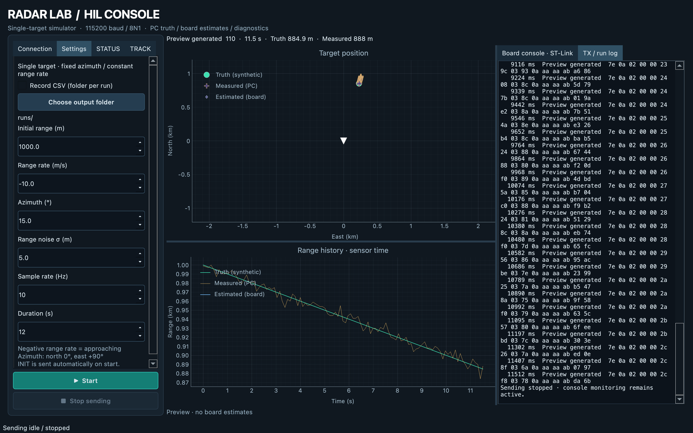
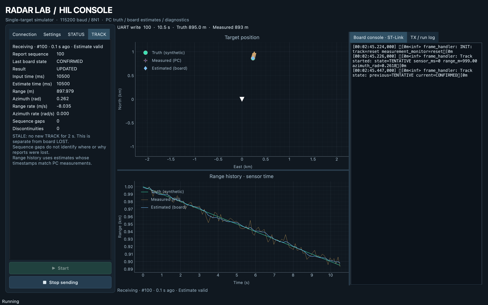

# radar-tracking-bench

<a id="radar-track-fcc-hil"></a>

[English](README.md) | **한국어**

이전 이름: `radar-track-fcc-hil`.

**STM32 · Zephyr 기반 단일표적 레이더 추적 HIL 프로젝트. 최신 릴리스: `v1.1.0`**

현재 `feat/prepared-input` 개발 브랜치에는 KF/EKF 빌드 선택, 측정 입력 저장·재사용, CLI/GUI 선회 잡음 평가를 추가했습니다. 아래 v1.1.0 실보드 수치는 당시 버전의 근거입니다. [현재 검증](docs/validation-2026-11-24-estimators.md) · [추정기 선택과 설정](docs/estimator-tuning.md).

초기 KF/EKF 실보드 비교에서는 입력3,020개가 모두 대응됐습니다. 현재 튜닝에서 EKF는 선회 전 직선 오차가 작았지만 선회 오차는 기존 KF보다 컸습니다. [결과·원시 데이터·그래프4종](docs/hardware-test-2026-11-24-kf-ekf.md).

후속으로 EKF 가속도 분산을 Kconfig로 분리하고 같은 입력의 host Q 탐색을 수행했습니다. 기본값100을 유지한 채 후보10000·30000의 host336회·실보드46회를 완료했습니다. 처음부터 멀어지는 잡음 선회를 포함해 보드 입력34,730개 모두 대응했고 일반 KF를 복원했습니다. [독립 시드·실보드 결과](docs/test-results/ekf-q-board-2026-11-24/README.md). [Q 비교표·그래프](docs/test-results/ekf-q-2026-11-24/README.md).

**릴리스 검증:** 30분 실보드에서 실제 전달한 측정89,057개 모두 응답했고 보드·전송·증거 검사를 통과했습니다. 최종 송신기 수정 후60초 검사도 유효 입력2,993개 모두 대응·보드 오류0입니다. PC 미송신과 RTT는 STM32 릴리스 차단 조건이 아닙니다. 요청50Hz 전체 입력의 검증 한계는 별도로 남깁니다. [완료 범위·검증 근거](docs/release-v1.1.0.md) · [v1.1.1 PC 송신기 개선](https://github.com/SungJaeYu/radar-tracking-bench/issues/8).

PC에서 합성 레이더 측정을 보내고, STM32에서 표적을 추적한 뒤 결과를 PC로 반환합니다.
정답·측정값·추정값을 비교하고, 통신 오류와 입력 이상치 이후의 복귀를 실보드에서 검증합니다.

[시작하기](#시작하기) · [구현 구조](EXPLAINER.md) · [검증 결과](#검증-결과) · [문서 목차](docs/README.md)

[프로젝트 보드](https://github.com/users/SungJaeYu/projects/1) · [할 일 이슈](https://github.com/SungJaeYu/radar-tracking-bench/issues) · [GUI 무음 시연·분석](docs/analysis/2026-11-23/README.md)

## 시스템 구성


PC는 추적 전 센서 측정을 모사합니다. **예측·게이팅·칼만 필터·트랙 상태 관리는 펌웨어가 담당**하며, PC의 정답 데이터는 결과 비교에만 사용합니다.

| 구성 | 주요 기능 |
|---|---|
| 펌웨어 | UART ISR·링버퍼, RX/처리/TX 스레드, CRC-16, polar CV KF / Cartesian CV EKF 빌드 선택, 트랙 생성·유지·소실 |
| 오류 처리 | 부분 프레임·무수신 timeout, overflow 복구, 오래된 측정 폐기, 누적 오류 통계 |
| PC 도구 | GUI·CLI, 측정·잡음·이상치 생성, STATUS/TRACK 수신, CSV 기록·정량 평가 |

ISR·큐·스레드의 연결과 데이터 소유권은 [구현 흐름](EXPLAINER.md), PC와 보드의 책임은 [시스템 역할](docs/system-roles.md)에 정리했습니다.

## GUI 미리보기



영어 UI의 **보드 없는 미리보기 모드**입니다. 합성 정답과 측정값을 표시하며 보드 추정값은 생성하지 않습니다.
[GUI 사용법·TRACK 화면](pc_sim/GUI.md) · [최신 실보드 추정값 캡처와 시험 기록](docs/hardware-test-2026-11-23-v1.1.0.md)



## 검증 결과

아래 결과는 서로 다른 시험 조건에서 얻은 관측값입니다. 상세 조건과 원시 기록은 각 링크에서 확인할 수 있습니다.

| 시험 | 확인한 결과 | 상세 |
|---|---|---|
| 30분 송수신 | 목표50Hz, 실제49.994Hz. 측정 **89,990개 모두 대응** | [성능 기록](docs/hardware-test-2026-11-19-performance.md) |
| 왕복 지연 | 위 부하에서 PC RTT **p99 8.049ms · 최대34.894ms** | [측정 경계·기준](docs/performance-monitoring.md) |
| 이상치·복귀 | 단발·5연속 거리/각도 이상치 **49/49회 통과** | [실보드 평가](docs/hardware-test-2026-11-19-noise-spike.md) |
| 잡음·정확도 | **100회** 잡음/seed 평가, 측정·추정 RMSE와 게이트 거부율 기록 | [조건별 결과](docs/hardware-test-2026-11-19-noise-spike.md#잡음100회) |
| 오류 복구 | CRC·부분 프레임, 데이터 선 단절·복원, 링버퍼·큐 포화 후 복귀 | [검증 이력](docs/verification-history.md) |

PC RTT는 USB·UART·보드·호스트 대기를 포함하는 진단값입니다. p99≤20ms·최대≤100ms 한도는 유지하며 초과만으로 STM32 불합격이나 릴리스 차단을 판정하지 않습니다. 현재 `passed`는 관측 부하의 보드 내부·전송·증거 합격을 뜻하며, 전 기간·슬롯 누락 없는50Hz 요청 부하 검증은 별도입니다. 당시 호스트 송신 간격 기준에 따른 실패 판정은 이력에 보존했습니다. 조건·판정 변경과 적용 범위는 [완료 기준](docs/roadmap.md#v1-acceptance)을 따릅니다.

## v1.1.0 추가 기능

PC 표적 운동에 일정 선회율의 원호 운동과 `straight_turn_straight` 구간 시나리오를 추가했습니다. 동쪽 직진10초 → 속도200m/s·뱅크30°의 우90° 선회 약55.49초 → 남쪽 직진10초이며 기존 시나리오도 유지합니다. v1.1.0 펌웨어는 거리·방위각 CV 필터를 사용했습니다. 현재 개발 브랜치에는 Cartesian CV-EKF도 추가했으며 CT 추정기는 후속입니다.

```bash
python -m pc_sim simulate --scenario straight_turn_straight --duration 80
```

`--port`를 생략하면 프레임만 출력합니다. 총 길이는 약75.49초이므로 기본60초로 실행하면 마지막 구간까지 진행하지 않습니다. `run_sim`은 측정 송신만 담당합니다. v1.1.0 GUI는 고정 방위각 입력을 사용했습니다. 현재 GUI `Tests → Turn + noise`와 CLI `turn-noise`는 저장된 선회 입력을 송신하고 보고를 수집합니다. 기본 `evaluate`는 고정 방위각 시나리오를 유지합니다.

11월23일 STM32 선회 시험은 측정 **755개 모두 대응**, 초기·최종 RESET을 포함한 **보고757개**, 측정 거부·트랙 소실0회를 확인했습니다. 첫2초를 제외한 위치 RMSE는 **전체4.5134m · 선회1.3960m**입니다. 정확도 합격 기준을 별도로 정한 결과는 아니며 이 조건의 관측값입니다. [시험 조건·원시 기록](docs/hardware-test-2026-11-23-v1.1.0.md).

## 시작하기

기준 환경은 **STM32F746G-DISCO · Zephyr 4.2 · Zephyr SDK 0.17.2**입니다.
보드 연결과 펌웨어 빌드·플래시는 [보드 시작 안내](docs/board-bringup.md)를 따릅니다.

PC 도구는 저장소 루트에서 실행합니다. 아래는 준비된 Zephyr Python 환경을 사용하는 예입니다.
GUI의 미리보기 모드는 보드 없이 실행할 수 있습니다.

```bash
source ~/zephyrproject/.venv/bin/activate
python -m pip install -r pc_sim/requirements-gui.txt
python -m pc_sim gui
```

- [GUI 사용법](pc_sim/GUI.md): 미리보기, 보드 연결, 측정·추정 그래프, 상태 조회
- [CLI·평가 도구](pc_sim/README.md): 측정 송신, CSV 수집, 잡음·이상치 시험
- [자동 테스트](docs/test-cases.md): Python 및 C host 테스트 실행 방법과 범위

## 추정기 선택과 선회 잡음 평가

기본 펌웨어는 polar CV KF이며, 별도 `build_ekf`에 `ekf.conf`를 적용하면 Cartesian CV EKF를 선택합니다. GUI에서 실행 중 필터를 변경하는 방식이 아니므로 빌드 후 해당 이미지를 flash해야 합니다. [빌드 명령·Q/R/초기 P](docs/estimator-tuning.md).

```bash
python -m pc_sim turn-noise --port PORT --noise 10 --azimuth-noise 0.01
```

잡음 인자는 각각 거리(m)·방위각(rad)의 표준편차입니다. GUI `Tests → Turn + noise`도 같은 실행기를 사용합니다. `--input`으로 저장 입력을 그대로 재사용할 수 있습니다. [입력 생성·검증](docs/prepared-input.md).

## V1 범위

<a id="portfolio-v1"></a>
<a id="v1-acceptance"></a>

**단일표적 결과 왕복·정량 평가·주요 오류 복구·시간/자원 관측까지 완료했습니다.**
다중표적·BIT·Lock On은 후속 확장입니다. 실제 RF 신호처리와 실운용 인증은 프로젝트 범위에 포함하지 않습니다.
[완료 범위와 후속 과제](docs/roadmap.md)를 참고하세요.

문서는 [사용·설계·검증·개발 기록](docs/README.md)으로 나누어 안내합니다. 날짜별 시험 기록에는 당시 버전·설정·한계를 보존합니다.

## 개발 방식

문제 정의·구조·검증 기준과 STM32/Zephyr 펌웨어는 직접 설계·작성했습니다.
PC 시뮬레이터와 GUI 구현에는 AI 코딩 에이전트를 활용했습니다.
모든 입력은 합성 측정 데이터이며 실제 군 운용 데이터나 내부 시스템 정보를 사용하지 않습니다.

## Estimator 실행 시간 계측 (2026-11-22)

`perf.conf`에서 predict/correct의 실행 cycle을 별도로 누적하고 5초 요약에 표본 수와 최소·평균·최대 ns를 출력합니다. 표본이 없으면 `status=no_samples`를 출력합니다. host/빌드와 STM32 10초 smoke에서 새 출력을 확인했습니다. WCET나 장시간 성능 보장은 아닙니다. [계측 범위·단위·한계](docs/performance-monitoring.md)를 따릅니다.

[2026-11-22 로그 형식·GUI/PC 실보드 회귀](docs/hardware-test-2026-11-22-logging.md)를 참고하세요.
