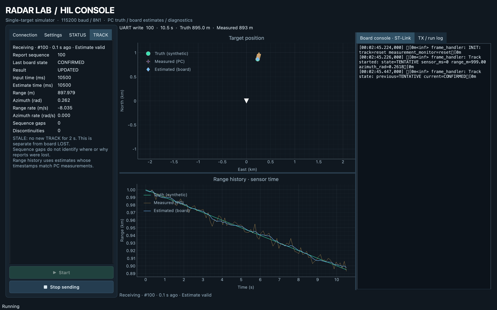
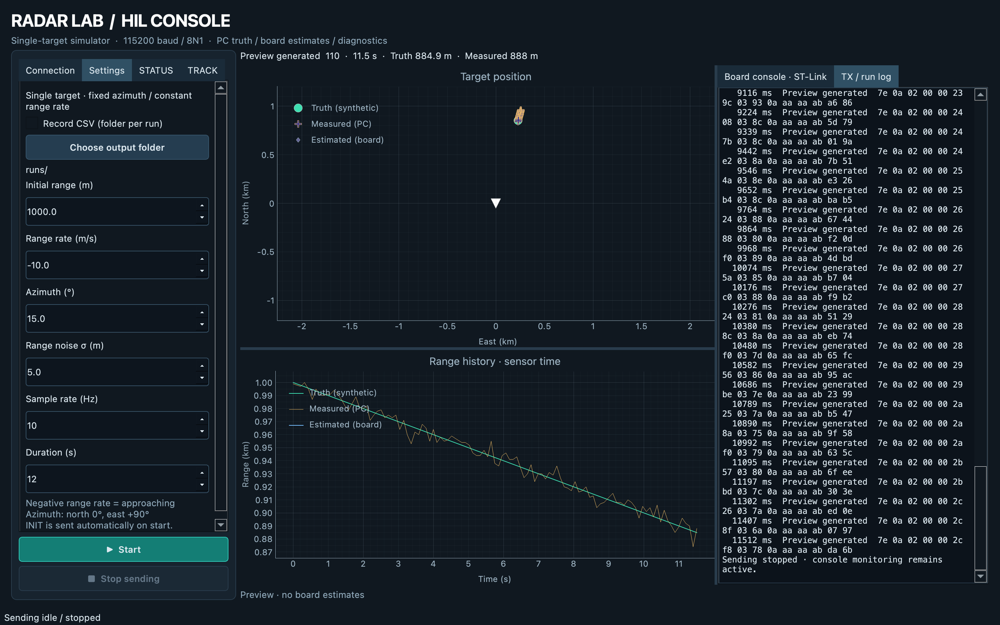

# radar-tracking-bench

<a id="radar-track-fcc-hil"></a>

**English** | [한국어](README.ko.md)

Previously named `radar-track-fcc-hil`.

**Single-target tracking HIL on STM32 and Zephyr. Latest release: `v1.2.0`.**

V1.2.0 adds build-time polar CV KF / Cartesian CV-EKF / CT-EKF selection, reusable measurement inputs, and 20 PC truth presets covering straight, turning, S-turn, acceleration/deceleration, and turn-rate-ramp motion. It includes a paired 80-condition STM32 comparison; the single-seed limits and build provenance are in the [release record](docs/release-v1.2.0.md). [Estimator setup](docs/estimator-tuning.md) · [Maneuver model and validation](docs/test-results/maneuver-models-2026-11-25/README.md).

The v1.2.1 candidate reduced mean MCU prediction plus correction time by 47.18% for CV-EKF and 30.66% for CT-EKF on one saved input. Each estimator returned identical UART bytes before and after the change. [Paired STM32 timing report](docs/analysis/ekf-timing-20261126/README.md).

The expanded STM32 grid compares the three estimators on the same 80 maneuver/noise inputs (seed 6). CV-EKF had the lowest pooled position RMSE (29.27 m); polar KF had the lowest observed estimator time (about 62 µs per predict/correct pair); CT-EKF performed poorly on acceleration/deceleration in this grid. All 55,000 measurements per estimator were matched with zero gate rejections or LOST transitions. This single-seed result is conditional, not a general ranking. [Conditions, figures and provenance](docs/analysis/maneuver-grid-20261126/README.md).

Initial paired board comparison: all 3,020 inputs matched. With the current tuning, Cartesian CV-EKF had smaller pre-turn straight error but larger turn error than polar CV KF. [Results, raw data, and four figures](docs/history/hardware-test-2026-11-24-kf-ekf.md).

The follow-up adds configurable EKF acceleration variance and a same-input host Q sweep. Default 100 is preserved. The candidates now have 336 host runs and 46 STM32 runs, including initially receding noisy turns; all 34,730 board inputs matched and normal KF was restored. [Independent-seed and board results](docs/test-results/ekf-q-board-2026-11-24/README.md). [Q comparison table and figures](docs/test-results/ekf-q-2026-11-24/README.md).

CT-EKF is implemented with a five-state constant-turn model and an owned 5×5 covariance. Its fixed-turn host comparison covers 84 saved inputs × three filters (252 runs); all had full valid coverage, no gate rejections, and no LOST states. CT parameters were selected on seed 42 and frozen before evaluating independent seeds. The 18-run STM32 comparison matched all 13,590 inputs with no gate rejections, LOST states, or STATUS errors; normal KF was restored. These are fixed-turn results, not evidence for the later expanded maneuver presets. [CT model, tuning, and comparison](docs/test-results/ct-ekf-2026-11-24/README.md).

**Release validation:** the 30-minute run matched all 89,057 delivered measurements and passed board, delivery and evidence checks. The final sender fix also passed a 60-second board check with all 2,993 valid inputs matched and zero board errors. Host RTT and unsent PC slots do not gate this STM32 release; the complete requested 50 Hz profile remains unqualified. [Release scope and evidence](docs/release-v1.1.0.md) · [PC sender improvement planned for v1.1.1](https://github.com/SungJaeYu/radar-tracking-bench/issues/8).

A hardware-in-the-loop testbed for post-detection radar tracking. A PC sends synthetic range and azimuth measurements to an STM32, then compares the returned estimates with known ground truth. It provides a repeatable way to evaluate tracking accuracy, response latency, and recovery from corrupted frames, measurement outliers, and interrupted communication without a physical radar.

[System overview](#system-overview) · [Board results](#board-results) · [Quick start](#quick-start) · [Scope](#scope-and-follow-up-work)

[Project board](https://github.com/users/SungJaeYu/projects/1) · [Open issues](https://github.com/SungJaeYu/radar-tracking-bench/issues) · [Silent GUI replay and analysis](docs/analysis/2026-11-23/README.md)

<a id="시스템-구성"></a>

## System overview


The firmware owns prediction, gating, Kalman updates, and track lifecycle management. Ground truth stays on the PC for evaluation; target IDs from the scenario are not sent to the board.

| Component | Implementation |
| --- | --- |
| Firmware | C, Zephyr RTOS, UART ISR and ring buffer, RX/handler/TX threads, bounded copying queues |
| Tracker | Build-time choice of polar CV KF, Cartesian CV-EKF, or CT-EKF; shared fixed gates and track acquisition/coasting/loss |
| Protocol and recovery | CRC-16, length validation, partial-frame and measurement timeouts, overflow recovery, stale-input rejection |
| PC tools | Python CLI and PySide6/pyqtgraph GUI, synthetic measurements, noise/outlier injection, TRACK/STATUS decoding, CSV recording and evaluation |


The UART ISR stores bytes in the RX ring and signals the RX thread. The RX thread validates frames and copies them into the handler queue together with their board receive time. The handler owns tracking state, the measurement watchdog, and report sequencing. It copies reports into the TX queue for a separate thread to send over UART.

Sensor time drives filter prediction and aligns estimates with ground truth. Board uptime drives queue age and the measurement watchdog. The PC monotonic clock measures round-trip latency. [Thread and queue contract (Korean)](docs/requirements-traceability.md#spec-exec) · [Wire format (Korean)](docs/requirements-traceability.md#spec-wire) · [Timing contract (Korean)](docs/performance-monitoring.md).

<a id="gui-미리보기"></a>

## English GUI



The GUI now uses English controls and compares PC ground truth and measurements with estimates decoded from the board's binary TRACK_REPORT. The separate no-board preview mode generates truth and measurements only; it does not simulate board estimates. [Current board evidence](docs/history/hardware-test-2026-11-23-v1.1.0.md) · [GUI guide — Korean](pc_sim/GUI.md).



<a id="검증-결과"></a>

## Board results

V1 was completed on **November 19, 2026**. These are recorded observations from separate runs. Linked reports are in Korean and include configuration, source revisions, and raw CSV/JSON or console records.

| Test | Recorded result | Evidence |
| --- | --- | --- |
| 30-minute load | Target 50 Hz measurements + 1 Hz STATUS; actual 49.994 Hz. **89,990 measurements, all matched with responses** | [Load run](docs/history/hardware-test-2026-11-19-performance.md) |
| PC round-trip latency | **p99 8.049 ms; maximum 34.894 ms** in that load run | [Timing definitions](docs/performance-monitoring.md) |
| Board processing interval | RX frame completion to TX queue submission: observed maximum **1 ms**, zero over the 20 ms budget | [Load run](docs/history/hardware-test-2026-11-19-performance.md) |
| Noise sweep | **100 runs** across noise levels and seeds, with response-integrity checks and RMSE/gate-rejection measurements | [Noise and spike results](docs/history/hardware-test-2026-11-19-noise-spike.md) |
| Spike recovery | **49/49 cases passed**, covering single and five-consecutive range/angle spikes | [Noise and spike results](docs/history/hardware-test-2026-11-19-noise-spike.md) |
| Error recovery | CRC/partial frames, RX/TX wire disconnection, forced DRAIN ring overflow, and RX/TX queue saturation | [Verification history](docs/verification-history.md) |

The load run used a stationary target, zero noise, `perf.conf` with DRAIN recovery, and USART6 at 115200 baud/8N1. PC round-trip timing includes USB, UART, board processing, and host waiting. The board interval ends at TX queue submission, before UART transmission completes.

Host RTT diagnostic limits remain p99 ≤20 ms and maximum ≤100 ms; exceeding them does not fail STM32 qualification or block release. The original load run failed its then-current host send-spacing criterion at 137.581 ms, and an earlier run recorded a maximum RTT of 164.128 ms. Those original verdicts are preserved. Current `passed` reflects board/delivery/evidence qualification at the observed load; full-duration, no-skipped-slot 50 Hz qualification is separate. See [V1 acceptance and measurement limits](docs/roadmap.md#v1-acceptance).

For the noise sweep, each of 10 conditions used 10 seeds with firmware tuning fixed. At 8 m range-noise standard deviation, the mean of per-seed RMSE values fell from **8.2528 m to 3.0805 m**. This is an observed accuracy result, not a separate accuracy pass threshold. Across the 100 noise and 49 spike sessions, all **17,880 measurements** had matching responses. These sessions used 10 Hz synthetic sensor time and actual send rates of 9.260–9.626 Hz; they are separate from the 50 Hz load run.

## v1.1.0 motion scenario

The PC motion generator adds exact constant-turn arcs and a segmented `straight_turn_straight` scenario: eastbound for 10 s, a 90° right turn at 200 m/s and 30° bank (about 55.49 s), then southbound for 10 s. Existing scenarios remain available. The v1.1.0 firmware used range/azimuth CV filters; Cartesian CV-EKF and CT-EKF were added in v1.2.0. Their comparisons are recorded separately in the estimator reports.

```bash
python -m pc_sim simulate --scenario straight_turn_straight --duration 80
```

Without `--port`, this prints frames. The scenario ends at about 75.49 s; the default 60 s duration would truncate it. `run_sim` sends measurements but does not collect reports. That v1.1.0 GUI used fixed-azimuth inputs. Current development adds `Tests → Turn + noise` and `python -m pc_sim turn-noise` for saved turn inputs and report collection. The standard `evaluate` command retains fixed-azimuth scenarios.

The November 23 STM32 turn run matched all **755 measurements**, with **757 reports** including two reset events, no rejected measurements or lost tracks. Position RMSE was **4.5134 m overall** and **1.3960 m during the turn**, excluding the first 2 s. These are observations for this run, without an accuracy acceptance threshold. [Conditions and raw evidence](docs/history/hardware-test-2026-11-23-v1.1.0.md).

<a id="시작하기"></a>

## Quick start

### Explore without a board

From the repository root, on a desktop with Python and a supported Qt environment:

```bash
python3 -m venv .venv
source .venv/bin/activate
python -m pip install -r pc_sim/requirements-gui.txt
python -m pc_sim gui
```

In `Connection`, keep `Preview · no board`, click `Connect preview`, then `Start`. No UART port is opened. [Detailed GUI guide — Korean](pc_sim/GUI.md).

To inspect the noise and spike plans without a board or output files:

```bash
python -m pc_sim noise-sweep --dry-run
python -m pc_sim spike-sweep --dry-run
```

### Run on STM32

Reference environment: **STM32F746G-DISCO, Zephyr 4.2, Zephyr SDK 0.17.2**. Use a configured Zephyr workspace and its Python environment for firmware builds.

The data link is **USART6, 115200 baud, 8N1, no flow control**:

| 3.3 V USB-UART adapter | STM32 connection |
| --- | --- |
| TXD | PC7 / USART6_RX |
| RXD | PC6 / USART6_TX |
| GND | GND |
| VCC / 5V / 3V3 | Leave unconnected; power the board and adapter through their own USB connections |

ST-Link USB is the separate flash/debug-console connection. Replace the repository path below with your checkout location:

```bash
source ~/zephyrproject/.venv/bin/activate
cd ~/zephyrproject
west build -d /path/to/radar-tracking-bench/build -b stm32f746g_disco /path/to/radar-tracking-bench/fcc_app
west flash -d /path/to/radar-tracking-bench/build --runner openocd
```

Return to the repository root and use the PC environment prepared above. Close the GUI and any other program using the data port before running the CLI. Replace `/dev/ttyUSB0` with the actual adapter port; macOS commonly uses `/dev/cu.usbserial...`.

```bash
python -m pc_sim status --port /dev/ttyUSB0 --timeout 2
python -m pc_sim evaluate run --port /dev/ttyUSB0 --scenario noisy
```

The evaluator sends measurements and collects board reports for CSV/RMSE evaluation. [Wiring and board setup — Korean](docs/board-bringup.md) · [CLI options and recording — Korean](pc_sim/README.md).

### Select the estimator and run a turn evaluation

The default firmware uses the polar CV KF. Add `-DEXTRA_CONF_FILE=ekf.conf` when configuring a separate `build_ekf` directory for Cartesian CV-EKF, or `-DEXTRA_CONF_FILE=ekf_ct.conf` with a separate `build_ct` directory for CT-EKF, then flash that build. The GUI cannot switch firmware algorithms at runtime. [Build commands and Q/R/P semantics](docs/estimator-tuning.md).

```bash
python -m pc_sim turn-noise --port /dev/ttyUSB0 --noise 10 --azimuth-noise 0.01
```

The noise options are standard deviations in metres and radians. GUI `Tests → Turn + noise` uses the same evaluator. Saved inputs can be reused with `--input`; see [input generation and validation](docs/prepared-input.md).

### Run host checks

From the repository root, using the PC environment above:

```bash
python -m pip install pytest
QT_QPA_PLATFORM=offscreen python -m pytest
```

Standalone C tests use CMake, Ninja, and a host C compiler. For example:

```bash
cmake -G Ninja -S fcc_app/tests/test_tracking -B /tmp/radar-track-tests -DTRACK_TEST_HOST=ON
cmake --build /tmp/radar-track-tests
ctest --test-dir /tmp/radar-track-tests --output-on-failure
```

Python and host C checks are separate from firmware builds and physical-board HIL runs. [Full test commands and coverage — Korean](docs/test-cases.md).

<a id="portfolio-v1"></a>
<a id="v1-acceptance"></a>
<a id="v1-범위"></a>

## Scope and follow-up work

V1 covers single-target measurement-to-result communication, quantitative tracking evaluation, major error recovery, and timing/resource observations. [V1 scope and verification (Korean)](docs/roadmap.md#v1-acceptance).

Cartesian CV-EKF and CT-EKF are implemented. The fixed-turn CT comparison and the expanded 80-condition maneuver/noise STM32 comparison are complete; the expanded grid uses one seed, and expanded-scenario GUI evaluation presets remain on issue #10. IMM, multi-target association, BIT/Lock On, and UART hardware-error diagnostics are separate follow-up work. RF processing, ADC/IQ/FFT, and operational certification are outside this project. [Project scope and roadmap — Korean](docs/roadmap.md).

<a id="개발-방식"></a>

## Authorship

I defined the problem, architecture, and validation criteria, and wrote the STM32/Zephyr firmware. I used AI coding tools for the PC simulator, GUI, and test-support implementation. All measurements are synthetic; no operational military data or internal system information is used.

[한국어 README](README.ko.md) · [Full documentation index — Korean](docs/README.md)

## Estimator execution timing (2026-11-22)

The `perf.conf` build aggregates predict/correct timer cycles separately and reports sample count and minimum/mean/maximum nanoseconds every five seconds. Aggregates are cumulative since boot; empty aggregates report `status=no_samples`. Host tests, firmware builds, and a 10-second STM32 smoke run validate the output path; these are not WCET or long-duration performance guarantees. See the [measurement contract](docs/performance-monitoring.md) for boundaries and limitations.

The [2026-11-22 log-format regression](docs/history/hardware-test-2026-11-22-logging.md) covers structured console logs and GUI/PC compatibility.
