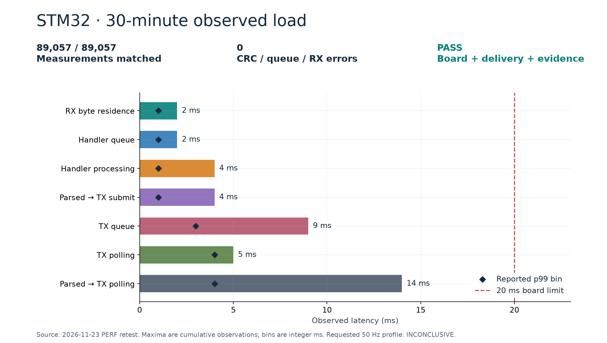
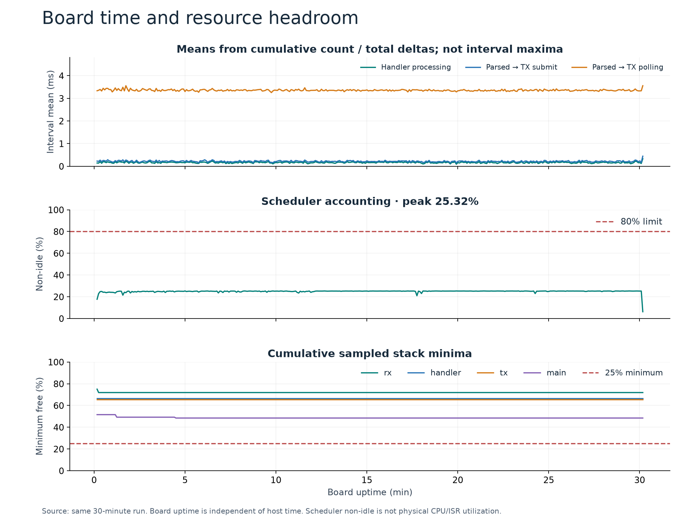
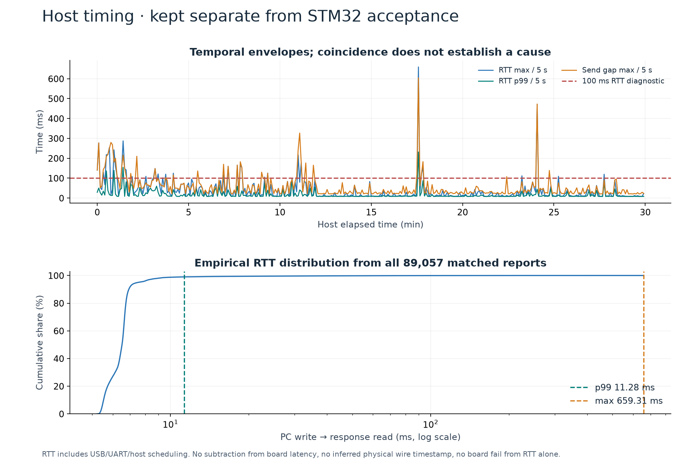
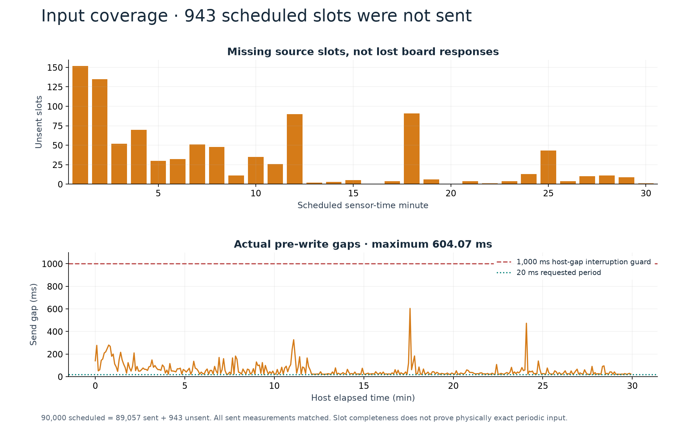
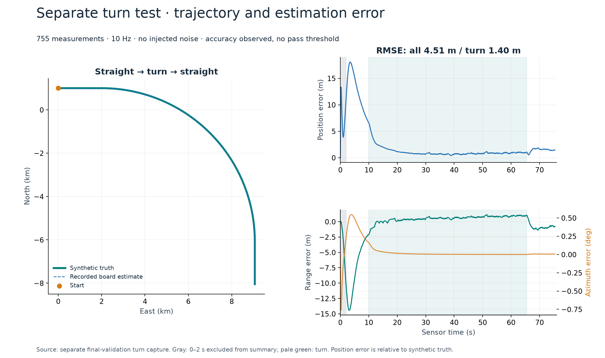

# 실보드 결과 분석과 GUI 동영상

[전체 HTML 보고서](index.html) · [무음 GUI 영상](gui-recorded-replay.mp4)

최신30분 관측 부하에서89,057개 입력 모두 대응·보드 오류0. 요청50Hz 전체는943개 미송신 슬롯으로 미확정이다.

영상은 이전 GUI 실보드 세션의 기록 재생이며 최신30분 시험이나 새 보드 실행이 아니다.

## 데이터에서 보이는 점

- 예정 입력의 1.05%가 미송신이었다. 누락943개 중 732개는 첫12분의 예정 슬롯에 집중됐다.
- RTT가100ms를 넘은 54건 중 43건은100ms 초과 송신 공백과 시간 구간이 겹쳤다. 이는 호스트 경로 지연과 부합하지만 특정 앱이나 스케줄러가 원인이라는 인과 증명은 아니다.
- 선회 시험에서는2–10초 초기 직선 구간이 warm-up 이후 전체 제곱 위치오차의 91.3%를 차지했다. 전체 RMSE만 보면 이후 구간의 오차를 구분하기 어렵다.

## 보드 지연과 판정

최댓값과 기록된 p99 구간을20ms 기준과 비교했다. 이 그림은 개별 보드 지연의 원시 분포가 아니다.



## 시간에 따른 보드 자원

누적 카운터의 차분으로 구간 평균을 계산했다. 스택은 누적 최소 여유이며, CPU는 스케줄러 비유휴 관측값이다.



## 호스트 지연

89,057개 입력과 응답을 센서 시각으로 연결한 뒤 동일한 PC monotonic 시계의 read−write를 계산했다. 최대659ms는 보드 지연으로 해석하지 않는다.



## 요청 부하가 미확정인 이유

943개는 보드가 잃어버린 응답이 아니라 PC가 송신하지 않은 예정 슬롯이다. 실제 송신한89,057개는 모두 대응했다. 정확한 물리 주기까지 증명한 것은 아니다.



## 별도 선회 시험

다른 실행의10Hz·무잡음 선회 기록이다. 최초2초를 제외한 위치 RMSE는4.513m, 선회 구간은1.396m였다. 합격 한계가 정해진 정확도 시험은 아니다.



## 재현

추가 의존성은 Matplotlib와 imageio-ffmpeg이며 기존 Zephyr 환경을 변경하지 않고 임시 폴더에 설치했다.

```sh
PYTHONPATH=/private/tmp/radar-report-deps /Users/yuseungjae/zephyrproject/.venv/bin/python tools/docs/analyze_board_results.py
PYTHONPATH=/private/tmp/radar-report-deps /Users/yuseungjae/zephyrproject/.venv/bin/python tools/docs/render_gui_video.py
```

[출처 해시와 수치 대조](analysis-provenance.json) · [영상 정보](video-provenance.json) · [분석 JSON](summary.json)

원시 자료, 펌웨어, 시험 판정은 변경하지 않았다. v1.1.0 완료 상태도 변경하지 않았다.
