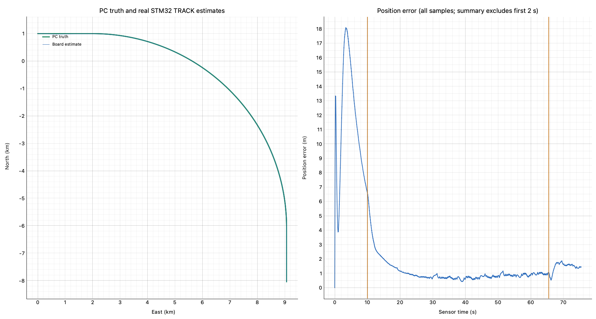
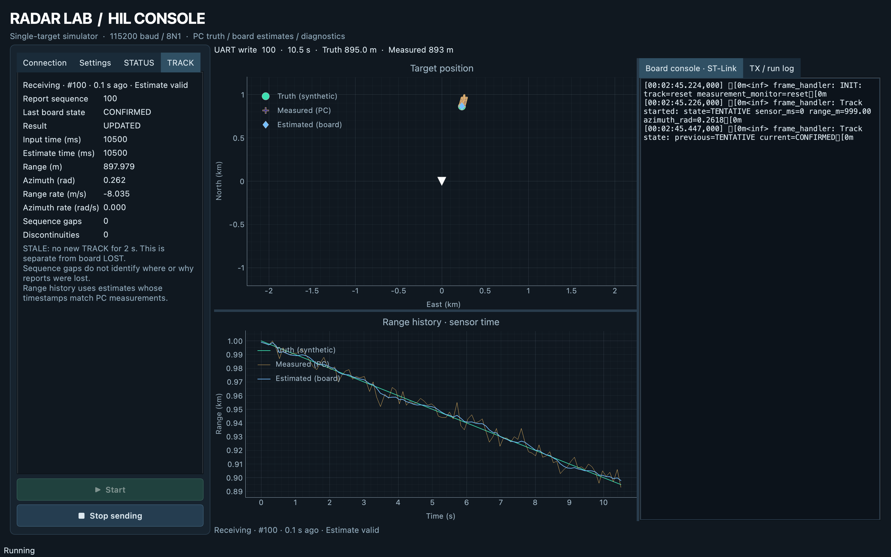

# v1.1.0 선회 시나리오·영어 GUI·실보드 회귀

2026-11-23, STM32F746G-DISCO / Zephyr 4.2 / USART6 115200 baud, 8N1.
이번 PC 변경은 `20f069f` 위 작업본이며 펌웨어 알고리즘·wire 형식은 변경하지 않았다.
소스·이미지 식별값과 단계별 명령은 원시 증거에 보존한다. **현재 RTT는 진단 전용이며 STM32 합격·릴리스 차단 조건이 아니다.** 이 문서의 최초 회귀·중간 실패 판정은 당시 기준의 이력이다. 최신 코드/판정/실행 결과와 미해결 항목은 [릴리스 검증과 실패 분석](release-v1.1.0.md)를 따른다. main 병합·태그는 아직 수행하지 않았다.

## 최신 ISR 계측 보완

인터럽트 차단 중 통계 집계와 ISR collector 호출을 제거한 뒤300초 재시험을 완료했다. CRC·보드 오류·계측 유실0, 유효 측정14,802개 모두 대응, 관측 부하의 내부/전송/증거 검사는 통과했다. 당시 종합 플래그는 RTT를 포함했지만 현재 기준의 관측 부하 보드 판정은 통과다. 예정 슬롯201개 누락으로 요청50Hz 프로파일은 미확정이고 RTT 최대328.516ms는 별도 진단값이다. 이전 CRC 원인도 아직 확정하지 않았다. [계측 실행 문맥](performance-monitoring.md#인터럽트와-계측-실행-문맥) · [최신 수치·원시 증거](test-results/irq-safe-perf-2026-11-23/README.md). 아래 실패 기록은 당시 결과로 보존한다.

## 후속 확장 계측 — 당시 기록

아래 최초 회귀의 기록과 수치는 당시 소스 기준이다. 이후 비동기 기록과 PERF 전용 RX/TX·CPU·main 스택 계측을 추가했고 판정 분류를 분리했다.
지연 한계를 늘리지 않았다. [현재 판정·미검증 범위](stm32-performance-coverage.md), [추가 실행 증거](test-results/extended-perf-2026-11-23/README.md)를 따른다.
이 단계의 Python893개+subtest9개, 확장 C host200개 등록 항목(220회 실행)과 firmware5구성이 통과했다.
60초 시험은 내부·전송·증거·RTT 통과, 요청50Hz 슬롯7개 누락으로 전체 미확정이다.
장시간 재시험은 약159초에 STM32 수신 CRC 오류1회로 중단됐다. 정상 이미지 복원·STATUS0을 확인했다.
PC 원시 기록의 CRC는 정상이지만 실제 수신선 신호가 보존된 것은 아니므로 물리 링크/보드 수신 원인을 아직 확정하지 않았다.
실패를 통과시키거나30분 완료로 기록하지 않으며 main 병합·v1.1.0 태그는 계속 보류한다.

## 추가 범위

- `Target.update(dt)`의 일정 선회율 원호 적분, 뱅크각/TAS 입력의 선회 시나리오.
- `MotionSegment`와 `SegmentedScenario`: 직진10초 → 우선회90도 → 직진10초.
- 경계에서 운동 계산만 분할하고 센서 표본 간격 유지. 총75.4868초, 종료 시각 미만 표본 생성.
- 영어 GUI 라벨·상태·오류 메시지, Python 영어 주석과 코딩 스탠다드.
- GUI와 기존 `evaluate`는 고정 방위각·일정 거리 변화율 모델을 유지한다. 선회 시나리오를 GUI에 연결한 릴리스가 아니다.

## 선회 실보드 시험 — 완료

TAS200m/s, 오른쪽 뱅크30도, 바람 없음·고도/속력 일정, 초기 위치 동0m/북1000m, 동쪽 출발.
구간 진입/종료에서 선회율을 즉시 바꾸며 기체 roll dynamics를 모사하지 않는다.
센서 시각10Hz, 거리·각도 잡음0. 거리 정수m 및 semicircle wire 양자화는 유지한다.
일반 firmware를 빌드 확인 후 flash했다. OpenOCD 최초 CPU probe에 경고가 있었으나 후속 인식·기록은 성공했고 명령 종료코드는0이었다.

데이터 `/dev/cu.usbserial-A5069RR4`, 콘솔 `/dev/cu.usbmodem11203`을 독점했다.
첫 실행은 sandbox의 UART 접근 차단으로 측정을 시작하지 못했다. 권한 허용 후 새 폴더에서 재실행했으며 첫 기록도 보존했다.

| 항목 | 관측 결과 |
|---|---:|
| 측정 송신 / 대응 응답 | 755 / 755 |
| 전체 TRACK | 757 (초기·최종 INIT 응답2 포함) |
| TENTATIVE / CONFIRMED 측정 응답 | 2 / 753 |
| 게이트·시간 거부 / 순번 공백 / 무효 추정 | 모두0 |
| 시작·종료 STATUS 오류 | 8개 카운터 모두0 |
| PC RTT p50 / p99 / 최대 | 5.499 / 7.188 / 17.746ms |

PC RTT는 write 직전부터 대응 TRACK을 포함하는 read 직후까지이며 USB·UART·호스트 처리를 포함한다.
이번 일반 이미지는 PERF 계측을 켜지 않았으므로 이 시험에서 MCU predict/correct 실행 시간을 측정하지 않았다.

첫2초를 제외하고 같은 센서 시각의 정답·보드 추정을 비교했다. 위치 오차는 보드 거리·방위각을 동/북 좌표로 변환한 뒤 계산했다.

| 구간 | 표본 | 거리 RMSE(m) | 방위각 RMSE(°) | 위치 RMSE(m) | 최대 위치 오차(m) |
|---|---:|---:|---:|---:|---:|
| 전체 | 735 | 2.9545 | 0.12978 | 4.5134 | 18.0742 |
| 선회 전 직진 | 80 | 8.7049 | 0.38730 | 13.0718 | 18.0742 |
| 선회 | 555 | 0.6897 | 0.02602 | 1.3960 | 6.5834 |
| 선회 후 직진 | 100 | 0.9466 | 0.00569 | 1.4872 | 1.8668 |

정확도 합격 임계값은 따로 정하지 않았다. `passed`는 응답 대응·상태·CRC/길이·진단 검사12개의 통과를 뜻하며 위 오차가 운용 요구를 충족한다는 뜻이 아니다.
선회 전 직진에서 더 큰 오차가 관측됐다. 현재 필터는 거리와 방위각의 변화율을 각각 추정하므로 이 결과를 단순히 "선회가 직진보다 쉽다"고 일반화하지 않는다.



원문: [결과](test-results/turn-2026-11-23/run-2/results.json), [메타데이터·해시](test-results/turn-2026-11-23/run-2/metadata.json), [wire 독립 재파싱](test-results/turn-2026-11-23/run-2/audit.json).
[실행 당시 수집기](test-results/turn-2026-11-23/run-2/board_check-snapshot.py)는 보존했다. 현재 수집기는 무응답 시 빈 RTT를 null로 기록하도록 후속 보완했다.

## Host·펌웨어 빌드 — 완료

- 영어 GUI 포함 Python 전체: **812 passed, 9 subtests passed**, skip0.
- C host: **149개 CTest 등록 항목 통과**, Tracking 묶음 내부까지169회 실행.
- 일반·DEBUG·PERF·로그 생성기·전송 스트레스 **5개 firmware 구성 빌드 성공**.
- 코드 리뷰에서 core 변경의 차단 문제는 없었고 시험 수집기의 빈 RTT 기록 경로를 보완했다.

## 전체 자동 실보드 회귀

| 시험 | 완료 결과 | 근거 |
|---|---|---|
| PERF 10초 smoke | 27개 판정 통과 | [결과](test-results/release-v1.1.0-2026-11-23/perf-smoke/results.json) |
| 전송 포화 STATUS | 95개 판정 통과 | [결과](test-results/release-v1.1.0-2026-11-23/transport-status/results.json) |
| 전송 포화 TRACK·제어 | 112개 판정 통과 | [결과](test-results/release-v1.1.0-2026-11-23/transport-track/results.json) |
| DEBUG 실제 입력 부하 | 11개 판정 통과, 로그 폐기 알림2878개 | [결과](test-results/release-v1.1.0-2026-11-23/logs-traffic/results.json) |
| 로그 생성기 | 13개 판정 통과, 로그 폐기 알림19882개 | [결과](test-results/release-v1.1.0-2026-11-23/logs-producer/results.json) |
| 정상·잡음·누락 기본 평가 | 측정120/120/105개 모두 대응, 순번 공백0 | [단계 로그](test-results/release-v1.1.0-2026-11-23/suite.json) |
| 잡음 행렬 | 100회 기록 완료, 12,000개 측정 모두 대응 | [요약](test-results/release-v1.1.0-2026-11-23/noise-summary.json) |
| 이상치 행렬 | 49/49회 통과, 실패0 | [요약](test-results/release-v1.1.0-2026-11-23/spike-summary.json) |
| 30분 PERF 부하 | 최대 RTT 기준 실패; 측정89,592개 모두 대응 | [결과](test-results/release-v1.1.0-2026-11-23/perf-load/results.json) |
| 정상 이미지 복원·smoke | 복원 성공, smoke48개 판정 통과 | [단계 기록](test-results/release-v1.1.0-2026-11-23/suite.json) |
| CRC·길이·부분 프레임 복구 | 8개 판정 통과, INIT의 진단 보존 확인 | [결과](test-results/release-v1.1.0-2026-11-23/protocol-errors/results.json) |
| 영어 GUI 실제 UART | 측정139개·TRACK140개, STATUS8개 모두0 | [결과](test-results/release-v1.1.0-2026-11-23/gui/result.json) |

로그 부하 시험의 로그 폐기는 의도된 조건이며 데이터 UART 오류와 구분한다. 해당 시험기는 모든 TRACK 수치·전달률을 검사하는 도구가 아니다.

잡음σ8m 조건의 seed10개 평균 거리 RMSE는 측정8.2528m → 추정3.0805m였다. 정확도 임계값을 별도로 적용한 판정은 아니다.

### 30분 부하 실패와 조사 경계

50Hz 요청·STATUS1Hz, 실제 평균49.7733Hz에서89,592개 측정과1,801개 STATUS 요청 모두 대응했다. PC CRC/길이 오류·보드 STATUS8개 카운터는0, 부팅은1회였다.

| PC RTT | 관측(ms) | 기준(ms) | 판정 |
|---|---:|---:|---|
| p50 / p95 | 5.534 / 6.709 | 참고값 | — |
| p99 | 9.080 | ≤20 | 통과 |
| 최대 | 220.246 | ≤100 | **실패** |

100ms 초과21건. 최대 RTT의 송신 시각에서 다음 송신까지219.419ms 공백도 겹쳤다. 호스트 슬롯408개가 건너뛰어졌으나 송신 간격 자체는 합격 기준이 아니다. [지연 상위 표본·송신 공백](test-results/release-v1.1.0-2026-11-23/perf-load/latency-tail.json).

보드 queue_wait·processing·RX→TX 제출 관측 최대는 각각1ms, 예산 초과0회였다. RX/TX 큐 거부0, TX 최대 관측 사용3개, 최소 스택 여유 RX784B/handler1360B/TX736B였다. predict89,591회 최소/평균/최대27.018/29.504/840.083µs, correct89,591회33.361/35.666/153.523µs. 인터럽트·선점 및 timer 조회가 포함될 수 있으며 WCET가 아니다.

호스트의 긴 공백과 RTT 꼬리가 함께 관측됐으나 원인을 OS 스케줄링·USB·동기 CSV/콘솔 기록 중 하나로 특정할 증거는 없다. 다음 조사는 write/read/기록 함수의 개별 소요 시간과 호스트 스케줄링 공백을 계측해야 한다. 기준 완화나 성공할 때까지의 무조건 재시도로 이번 실패를 대체하지 않았다.

후속 [RTT 원인 조사](test-results/rtt-investigation-2026-11-23/README.md)에서3분 구간별 계측과 UART 없는1분 타이머 대조 시험을 수행했다. 요청1ms sleep이 실제55.620ms(CPU0.036ms) 걸린 구간과 RTT58.734ms가 겹쳤고, UART 없는 대조에서도 최대21.577ms(CPU0.026ms)를 관측했다. 호스트 대기가 RTT에 기여함은 확인됐지만 원래220.246ms 표본의 정확한 호출 원인은 미확정이다. 짧은 진단 실행은 최대83.700ms였으며 기존30분 실패를 대체하지 않는다. 정상 펌웨어 복원·STATUS0을 다시 확인했다.

[단계별 실행 기록](test-results/release-v1.1.0-2026-11-23/suite.json)의 `passed=false`를 유지했다. 정상 이미지 복원 후 오류 주입 검사를 수행했고, GUI 검증 전에 정상 이미지를 다시 flash했다.

물리 케이블 탈착·전원 재인가, UART 하드웨어 오류 전 종류, DISCARD 정책의 전체 보드 행렬은 이번 자동 시험에 포함하지 않는다. 과거 물리 시험의 증거는 해당 날짜 기록으로 남긴다.

## 기록 스레드 재시험과 판정 검토

후속 기록 스레드 분리 후 Python820개+subtest9개 통과. 60초 smoke는 기록12,547개 모두 저장·원시 RX/CSV 일치·보드 내부 관측 최대1ms였으나 PC RTT 최대158.108ms로 기존 판정 실패다. 계측을 켠 별도60초 진단에서는 최대83.282ms였고 요청1ms sleep이75.000ms 걸리는 호스트 대기를 확인했다. 두 실행 모두 정상 이미지 복원·STATUS0이다. [재시험 결과와 판정 범위 검토](test-results/rtt-investigation-2026-11-23/README.md).

**판정 해석:** 기존 `passed=false`는 호스트 포함 HIL RTT 예산 실패이며 STM32 내부 처리 성능 실패를 뜻하지 않는다. 기록된 보드 내부 검사들은 통과했다. 보드/통신 기능·시험 유효성/호스트 RTT의 별도 판정을 제안했고, 실행 정책과 원래 결과를 임의로 변경하지 않았다.

## 영어 GUI 캡처

미리보기 캡처는 보드 없이 새 영어 UI에서 다시 생성했다. 아래 화면은 정상 STM32 이미지의 실제 TRACK·STATUS·ST-Link 로그를 수신한 영어 GUI다. Qt offscreen 렌더링을 사용했으며 사람이 native 창을 직접 조작한 시험은 아니다. 거리 변화율−10m/s, 거리 잡음σ5m, 방위각15°,15초 설정에서139개 측정을 기록했다. 캡처 시점은100번째 측정, CONFIRMED·UPDATED·순번 공백0이다.



[설정 탭 캡처](test-results/release-v1.1.0-2026-11-23/gui/gui-settings.png), [GUI 검증 수집기](test-results/release-v1.1.0-2026-11-23/gui_check.py). 콘솔 창은 수신 원문을 표시하므로 펌웨어 ANSI 색상 제어 문자열도 보인다.

## 원시 증거 검증

155개 세션의 원시 RX 바이트를 독립 재파싱해108,459개 측정·108,924개 TRACK 기록을 대조했다. 저장된 보고/STATUS 값이 모두 일치하고 PC CRC·길이 오류0을 확인했다. 이 검증은 지연 합격 판정을 바꾸지 않는다. [wire 감사](test-results/release-v1.1.0-2026-11-23/wire-audit.json).

잡음·이상치·30분 세션은 원본을 삭제하지 않고 압축했다. 압축을 다시 읽어 모든 파일의 SHA256을 대조했다. [파일·소스 해시 manifest](test-results/release-v1.1.0-2026-11-23/manifest.json), [잡음 원본](test-results/release-v1.1.0-2026-11-23/noise.tar.gz), [이상치 원본](test-results/release-v1.1.0-2026-11-23/spike.tar.gz), [부하 원본](test-results/release-v1.1.0-2026-11-23/perf-load-session.tar.gz).

## 재현

선회 CLI 출력/송신:

```sh
python -m pc_sim simulate --scenario straight_turn_straight --duration 80 --noise 0 --azimuth-noise 0
```

선회 보드 수집·분석은 아래처럼 새 출력 폴더를 사용한다. 실행 환경의 포트로 교체한다.

```sh
python docs/test-results/turn-2026-11-23/board_check.py \
  --port DATA --console CONSOLE --output /tmp/new-turn-run
python docs/test-results/turn-2026-11-23/analyze.py /tmp/new-turn-run
```

전체 suite 스크립트는 당시 로컬 경로·포트가 지정된 증거용이다. 재실행하려면 출력 폴더·포트를 바꾸고 기록을 덮어쓰지 않는다.

후속60초 재시험도 약19초에 보드 CRC 오류1회로 중단됐다. PC RTT p99 25.616ms·최대101.118ms로 한계를 초과했다. 정상 이미지 복원·STATUS0을 확인했으며 원시 결과와 중단 판정 보완의 재평가를 별도 보존했다.
