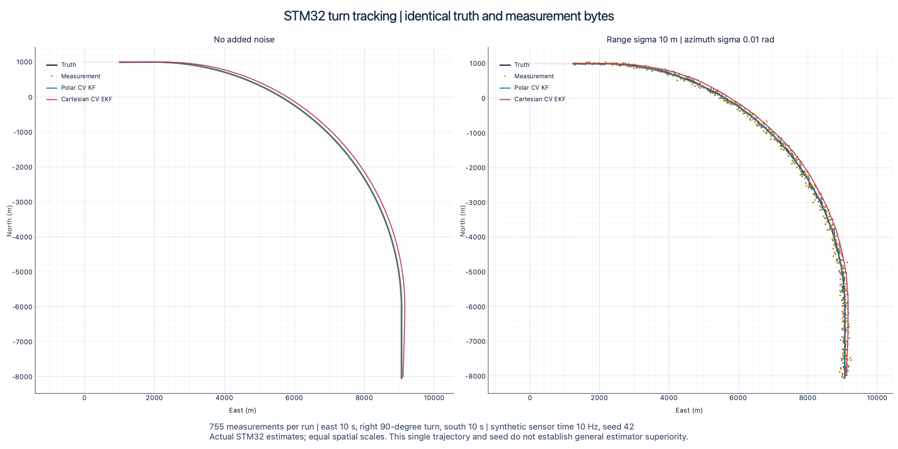
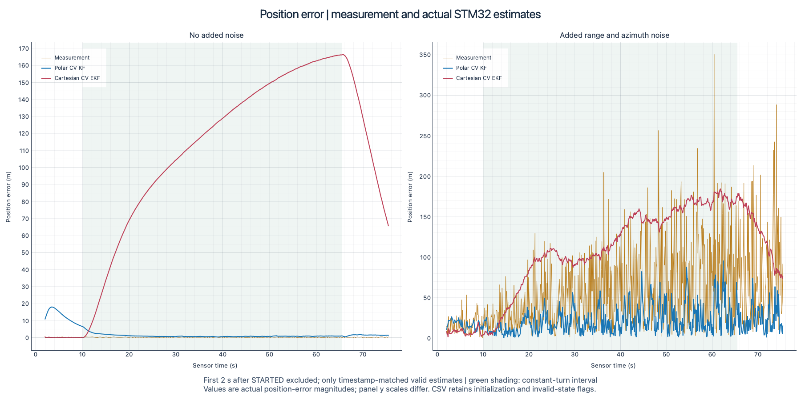
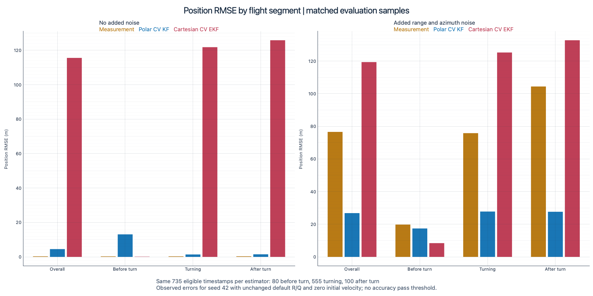
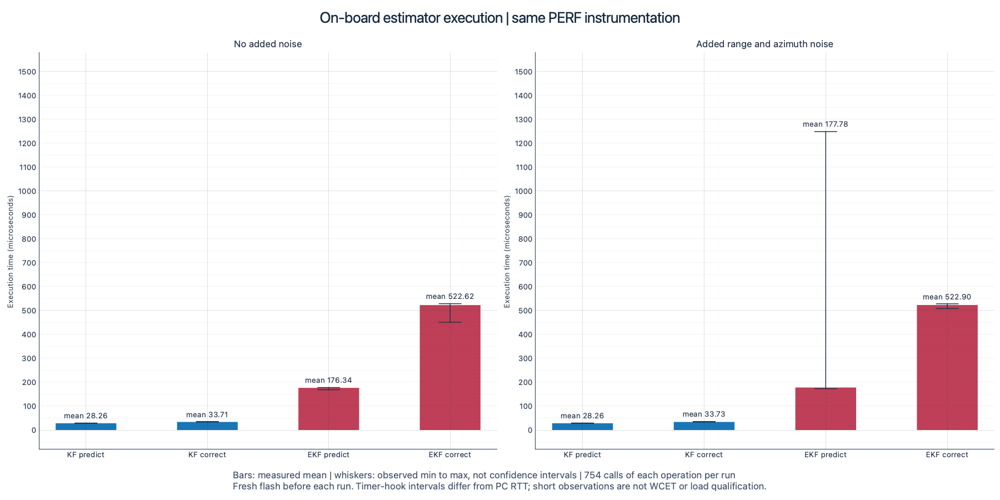

# KF / Cartesian CV-EKF 동일 입력 실보드 비교 — 2026-11-24

**4회 실행, 측정 3,020개 모두 대응. 통신 오류·게이트 거부·추적 소실 0회.** 현재 기본 튜닝에서는 EKF의 선회 전 직선 오차가 작았고, 선회·선회 종료 오차는 기존 polar KF보다 컸다. 정확도 합격 기준을 정한 시험은 아니며 모델·튜닝을 포함한 현재 구현 두 개의 비교다.

기능 소스는 `cd27620`, 실행 당시 저장소는 [`4a9e6ea`](https://github.com/SungJaeYu/radar-tracking-bench/commit/4a9e6eaad3c3063d99e7821913396e9b53a6da78)이다. host·빌드 검증은 [별도 기록](validation-2026-11-24-estimators.md), 원시 자료와 재현 명령은 [데이터 묶음](../test-results/kf-ekf-2026-11-24/README.md)에 있다. 시험 종료 후 **일반 KF 이미지를 복원하고 STATUS 8개 항목 0**을 확인했다.

## 조건과 비교 기준

- STM32F746G-DISCO, Zephyr, USART6 115200/8N1. 각 실행 전에 새로 flash하고 ST-Link 콘솔을 별도 기록했다.
- KF는 `prj.conf + perf.conf`, EKF는 `prj.conf + perf.conf + ekf.conf`. 생성된 두 `.config`의 차이는 estimator 선택 두 줄뿐이다. 둘 다 size 최적화·동일 계측을 사용한다.
- 동쪽 직진 10초 → 200m/s·뱅크30°의 우90° 선회 약55.487초 → 남쪽 직진10초. 센서 시각 0.0–75.4초, dt0.1초, 755개 입력이다.
- 무잡음과 거리 σ10m·방위 σ0.01rad(약0.573°), seed42의 입력을 먼저 저장했다. 각 조건에서 KF/EKF가 보낸 순서·sensor timestamp·프레임 바이트가 모두 같음을 사후 검증했다.
- 송신 후 dt 동안 수신하는 FIFO 방식이다. 실제 평균 write 간격은 103.707–103.893ms이며 정밀10Hz/50Hz 부하 인증이나 lockstep 시험이 아니다.
- 거리 R=25m², 방위 R=0.00121847rad², 초기 속도0과 기존 초기 P를 유지했다. EKF 초기 P는 첫 측정 위치에서 좌표 변환한다. **Q는 좌표계에 따라 의미가 다르다**: KF는 거리 가속도 분산100·각가속도 분산0.00761544, EKF는 x/y 가속도 분산100을 사용한다. [단위·초기값](../estimator-tuning.md).
- 모든 실행에서 STARTED는1회다. 처음2초를 제외한 같은735개 시각(선회 전80, 선회555, 선회 후100)으로 비교했다. 초기 구간을 포함한 값과 표본별 상태도 [summary.json](../test-results/kf-ekf-2026-11-24/summary.json)·[series.csv](../test-results/kf-ekf-2026-11-24/series.csv)에 남겼다.

## 위치 오차

단위는 m이며 측정값은 실제 wire 양자화 이후 좌표로 계산했다. 무잡음에도 정수 거리 양자화 오차가 있다.

| 조건 | 측정 위치 RMSE | KF 위치 RMSE | EKF 위치 RMSE |
|---|---:|---:|---:|
| 무잡음 | 0.290 | 4.513 | 115.557 |
| 거리 σ10m · 방위 σ0.01rad | 76.588 | 26.817 | 119.373 |

| 조건 | 추정기 | 선회 전 RMSE | 선회 RMSE | 선회 후 RMSE |
|---|---|---:|---:|---:|
| 무잡음 | KF | 13.072 | 1.396 | 1.487 |
| 무잡음 | EKF | 0.132 | 121.787 | 125.815 |
| 거리 σ10m · 방위 σ0.01rad | KF | 17.403 | 27.769 | 27.636 |
| 거리 σ10m · 방위 σ0.01rad | EKF | 8.415 | 125.244 | 132.749 |

### 해석과 독립 계산

확인된 현상은 선회 시작 이후 EKF 오차가 증가하고 직선으로 돌아온 뒤에도 수렴 시간이 남는다는 것이다. 게이트는 거리·방위 잔차 각각의 고정 경계이므로 위치 오차가100m를 넘는다는 이유만으로 반드시 거부되는 구조는 아니다. 이번에는 두 필터 모두 게이트 거부와 LOST가0이었다.

독립적인 NumPy float64 계산으로 같은 Cartesian CV 상태전이·극좌표 측정 Jacobian·Joseph 공분산 식을 다시 실행했다. 보드 출력과의 최대 위치 차이는 무잡음 **4.053mm**, 잡음 **4.690mm**였다. reference의 전체 RMSE도 각각 115.557m / 119.373m로 재현됐다. [독립 계산·결과](../test-results/kf-ekf-2026-11-24/reference-ekf.json).

따라서 이 입력에서100m 규모의 차이가 생긴 원인을 큰 수치 구현 불일치로 보기는 어렵다. **현재 Cartesian CV 운동 모델과 Q/R 설정의 선회 응답에 따른 차이로 해석할 근거가 있다.** EKF는 비선형 측정 모델을 다루지만, 현재 상태전이는 일정 속도이며 선회율 상태를 추가한 CT 모델이 아니다. 다만 모델과 튜닝의 기여를 각각 분리한 실험은 아직 하지 않았다.

Q/R을 바꾸지 않고 이번 결과를 기준선으로 보존한다. 향후 Q/R 탐색과 CT 모델 비교는 같은 입력을 사용하되, 튜닝 seed와 평가 seed를 분리한다. 이 한 조건으로 KF/EKF 전체의 우열이나 실제 레이더 성능을 일반화하지 않는다.

## 실행 비용과 자원

단위는 µs, 표는 평균 / 관측 최대다. 각 실행의 predict/correct는 각각754회다. 첫 측정은 초기화만 한다.

| 조건 | 추정기 | Predict 평균 / 최대 | Correct 평균 / 최대 |
|---|---|---:|---:|
| 무잡음 | KF | 28.259 / 29.092 | 33.708 / 35.060 |
| 무잡음 | EKF | 176.337 / 177.643 | 522.615 / 528.597 |
| 거리 σ10m · 방위 σ0.01rad | KF | 28.259 / 29.212 | 33.731 / 35.407 |
| 거리 σ10m · 방위 σ0.01rad | EKF | 177.782 / 1248.601 | 522.898 / 527.944 |

잡음 EKF predict에서 **1,248.601µs** 최대가 관측됐다. 계측은 함수 호출 전후 timer cycle 구간이며 인터럽트·선점 시간을 완전히 분리한 CPU 명령 비용이 아니다. 누적 요약만으로 이 최대의 원인을 특정할 수 없다. 평균은 약178µs이며 이 짧은 시험의 최대를 WCET로 주장하지 않는다. PC RTT도 별도 지표다.

| 항목 | KF + PERF | EKF + PERF |
|---|---:|---:|
| Flash 사용량 | 48,708 B | 56,332 B |
| 링크 시 RAM 영역 사용량 | 21,184 B | 21,184 B |
| handler stack 최소 잔여 관측 / 할당 | 1,104 / 2,048 B | 736 / 2,048 B |
| RX / TX / main 최소 잔여 관측 | 776 / 672 / 528 B | 776 / 672 / 528 B |

handler 잔여 관측은 각각53.9% / 35.9%로 현재25% 기준보다 컸다. stack fill 조회의 관측값이며 모든 경로의 최악 사용량 보장은 아니다. 동일한 링크 RAM 수치가 함수 stack 사용도 동일하다는 뜻은 아니다. RX 완료→TX 제출 최대는 KF1ms, EKF2ms였고20ms 초과는0회다. 이 결과를 새로운 지속 부하 합격으로 확장하지 않는다.

## 기록 무결성과 한계

각 실행에서755개 측정·757개 TRACK(INIT/RESET2개 포함)·STATUS2개를 기록했다. 합계3,020개 입력·3,028개 TRACK이다. 저장된 raw RX를 CRC 재파싱하여 보고 CSV와 일치함을 확인했고, input 프레임·실제 TX·보존된 input 복사본도 바이트 일치를 확인했다. STATUS 증가량, 순번 누락/역행, parser 오류, PERF 제출 실패·큐 거부·시각 오류·계측 유실·console fault는0이었다.

단일 궤적·seed42·각 조건1회이며 실제 센서, 다른 속도/선회 강도, 여러 seed, 반복 실행 시간 분포, CT-EKF, 최대 부하 검증은 포함하지 않는다. 정확도·재획득에 관한 합격 기준도 새로 설정하지 않았다. #10은 이 초기 비교만으로 종료하지 않는다.
