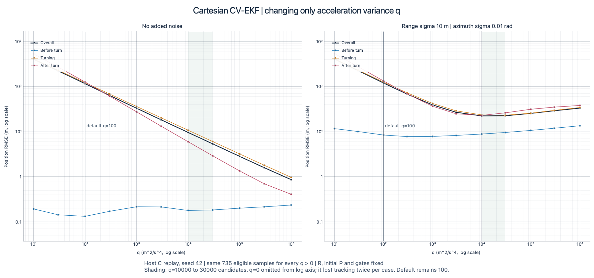
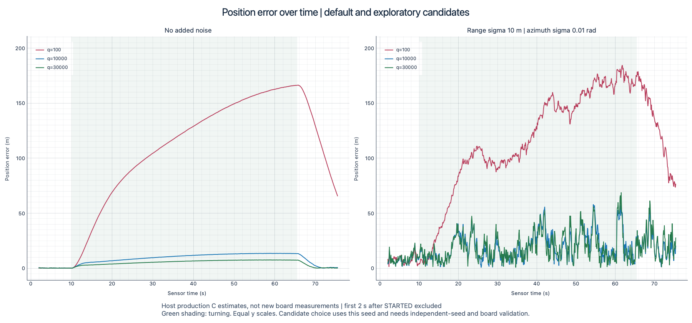

# EKF Q 설정과 같은 입력 host 탐색 — 2026-11-24

EKF의 가속도 분산 `q`를 Kconfig로 분리하고, 기존 STM32 비교에 사용한 입력을 실제 C 처리기로
재생했다. **기본값100은 유지**한다. 잡음 조건의 탐색 후보는 `10000·30000`이며,
단일 시드에서 고른 값이므로 독립 시드·다른 기동·실보드 검증 전에는 최적값으로 간주하지 않는다.

[설정 사용법](../../estimator-tuning.md) · [집계 CSV](summary.csv) · [JSON](summary.json) ·
[표본별 CSV gzip](series.csv.gz) · [소스·입력·실행 해시](manifest.json) · [검증 기록](validation.json)

## 변경과 실험 조건

- 생산 코드 변경: `fcc_app/Kconfig`의 EKF 전용 정수 설정과 `cartesian_cv_ekf.c`의 예측 인자.
  수치 필터·초기 P·R·게이트·추적 정책·기존 시험 기대값은 유지했다.
- 설정: `CONFIG_RADAR_EKF_ACCELERATION_VARIANCE_M_SQUARED_PER_S_FOURTH`, 기본100,
  범위0..2147483647, 단위 **m²/s⁴ = (m/s²)²**. 아래 표의 Q는 이 스칼라 `q`를 가리킨다.
  x/y 독립 축에 공통 적용하고 각 축 Q 블록에 `dt⁴/4, dt³/2, dt²`를 곱한다.
- R: 거리25m², 방위0.00121847rad². 직사각형 게이트100m/10°, 초기 속도0 및 초기 P 유지.
- 입력: [이전 실보드 archive](../kf-ekf-2026-11-24/evidence.tar.gz)의 `recording/inputs`.
  동쪽 직선10초 → 우90° 선회 약55.49초 → 남쪽 직선10초, 센서 시각10Hz, seed42.
  조건별755개, 무잡음 및 거리σ10m/방위σ0.01rad. 무잡음에도 wire 양자화 오차는 존재한다.
- 입력 생성·재샘플링 없이 저장된10바이트 payload를 사용했다. `load_input`이 저장 데이터와 CRC를
  검증하고 `replay.c`가 실제 `radar_processor → track → estimator → EKF`를 실행한다.
  UART·스레드·송신·수신 timeout 실행은 포함하지 않으며 host 실행 시간을 MCU 시간으로 해석하지 않는다.
- host: Apple Clang, float32 C, `-O0 -ffp-contract=off`, ASSERT 비활성. 컴파일 명령·버전·소스 해시는
  manifest에 있다. 입력 해시는 이전 실보드 자료와 동일하다.

## 전체 위치 RMSE

STARTED 이후 첫2초를 제외한, 입력 시각과 일치하는 유효 추정값의 위치 오차다.
Q>0은 모두 **755/755 유효**, 평가735개(선회 전80·선회555·선회 후100), 게이트 거부/LOST0,
STARTED1회, 최초 CONFIRMED0.2초다. 두 조건 ×12설정 =24실행, 전체18,120표본을 보존했다.

| Q (m²/s⁴) | 무잡음 RMSE (m) | 잡음 RMSE (m) | 게이트 거부 무잡음/잡음 | LOST 무잡음/잡음 |
|---:|---:|---:|---:|---:|
| 0 | 844.051* | 888.725* | 10 / 30 | 2 / 2 |
| 10 | 403.655 | 406.320 | 0 / 0 | 0 / 0 |
| 30 | 222.942 | 226.017 | 0 / 0 | 0 / 0 |
| **100 (기본)** | **115.557** | **119.372** | 0 / 0 | 0 / 0 |
| 300 | 63.415 | 68.032 | 0 / 0 | 0 / 0 |
| 1000 | 32.984 | 39.089 | 0 / 0 | 0 / 0 |
| 3000 | 18.263 | 26.876 | 0 / 0 | 0 / 0 |
| **10000** | **9.603** | **22.282** | 0 / 0 | 0 / 0 |
| **30000** | **5.357** | **22.484** | 0 / 0 | 0 / 0 |
| 100000 | 2.831 | 25.366 | 0 / 0 | 0 / 0 |
| 300000 | 1.589 | 29.067 | 0 / 0 | 0 / 0 |
| 1000000 | 0.862 | 33.240 | 0 / 0 | 0 / 0 |

\* Q=0은 각 조건751/755 유효, STARTED3회, 평가691개다. 재시작 후에도 첫2초를 제외하므로
다른 행과 평가 시각이 다르다. CSV의 `common_*`는 각 후보와 기본값의 공통 평가 시각만 비교한다.
Q=0의 공통691개에서 기본값 RMSE는 무잡음114.376m/잡음118.544m다. Q=0의 최대 연속 거부는5다.
무효4개를 제외한 RMSE만으로 추적 품질을 판단하지 않는다. 모든 유효 구간과 warm-up의 오차도
`all_valid_rmse_m`, `warmup_rmse_m`에 별도로 기록했다.



## 후보의 구간별 차이

| 조건 | Q | 선회 전 (m) | 선회 (m) | 선회 후 (m) |
|---|---:|---:|---:|---:|
| 무잡음 | 100 | 0.132 | 121.787 | 125.814 |
| 무잡음 | 10000 | 0.179 | 10.756 | 5.973 |
| 무잡음 | 30000 | 0.183 | 6.039 | 2.914 |
| 잡음 | 100 | 8.415 | 125.244 | 132.747 |
| 잡음 | 10000 | 8.854 | 23.487 | 22.907 |
| 잡음 | 30000 | 9.580 | 23.099 | 26.096 |

Q 증가가 이번 선회의 지연 오차를 줄였다. 하지만 큰 Q에서 잡음 조건의 오차가 다시 증가하고,
선회 전 직선의 잡음 억제도 약해진다. `10000`은 시험한 격자에서 잡음 전체 RMSE가 가장 작지만,
`30000`과 약0.20m 차이에 통계적 유의성을 부여하지 않는다. `30000`은 무잡음 선회 오차가 더 작아
함께 후보로 남긴다. 이 값은 모델 불일치까지 흡수하는 튜닝 계수이며 실제 가속도 분산의 측정값이 아니다.
CT 모델의 필요성이나 우열을 이번 Q 탐색만으로 결정하지 않는다.



## 기본값 보존과 검증

- 변경 전 `cee58d7`의 adapter를 나머지 동일 생산 소스와 컴파일했다. 새 Q=100과 두 조건의
  **1,510개 출력4float·상태/결과/시각3uint32가 바이트 단위로 동일**했다.
  변경 전에 별도로 보존한 라이브러리와도 동일했다. 다른 생산 소스·헤더가 기준 commit과 같은지 검사한다.
- 기존 STM32 Q=100 기록과 host 위치의 최대 차이: 무잡음2.957mm, 잡음5.712mm.
  이는 기존 보드 자료와의 대조이며 이번 변경의 새 보드 실행이 아니다.
- Q 설정 시험4개: 0·100·10000·최댓값에서 x/y 축 공분산 증가를 독립 폐쇄식과 비교한다.
  변경 전에는 기본값만 통과하고 나머지3개 실패, 연결 후에는4개 모두 통과했다.
- CTest: Tracking31, handler KF31/EKF31, EKF core2 =95회, ASSERT 비활성 core2회 별도 통과.
  Python1,058개와 subtest9개 통과. 기존 테스트 본문/기대값은 변경하지 않았다.
- STM32 빌드: KF 기본, EKF 기본100, EKF10000 모두 통과. 생성 `.config`에서 선택과 Q를 확인했다.
  EKF 두 설정은 Q 한 줄만 다르고 R·P·게이트는 유지한다. 전체 설정과 이미지 해시는 validation에 있다.
  KF Flash43,348B, EKF 두 구성50,972B, RAM모두15,696B. 빌드가 새 flash를 의미하지 않는다.
- 독립 검토에서 압축 CSV의18,120개로24개 RMSE와 공통 시각 집계를 재계산해 일치를 확인했다.

## 재현

저장소 루트, 이 변경을 포함한 revision과 Git 이력이 필요하다. Python3.10+와 Clang을 사용한다.
그림 생성에만 NumPy·PySide6·pyqtgraph가 필요하다. 아래는 보드에 접근하지 않는다.

```sh
mkdir -p /tmp/radar-q-inputs
tar -xzf docs/test-results/kf-ekf-2026-11-24/evidence.tar.gz -C /tmp/radar-q-inputs
python docs/test-results/ekf-q-2026-11-24/sweep.py /tmp/radar-q-inputs/recording/inputs --build-dir /tmp/radar-q-build --output /tmp/radar-q-output
python docs/test-results/ekf-q-2026-11-24/plot.py /tmp/radar-q-output
```

원래 실행에는 변경 전 라이브러리를 지정하는 `--before-library`도 사용했다.
재현 시에는 생략할 수 있으며, 기준 commit의 adapter와 비교는 항상 실행한다.
`summary.csv/json`과 `series.csv.gz`는 같은 컴파일러에서 동일하다.
manifest의 절대 경로·라이브러리 해시·추가 비교 플래그는 실행 위치에 따라 달라진다.

후속 보드 후보 빌드는 Zephyr workspace에서 별도 디렉터리와
[`configs/q-10000.conf`](configs/q-10000.conf) 또는 [`configs/q-30000.conf`](configs/q-30000.conf)를 사용한다.

```sh
west build -d <repo>/build_ekf_q_trial -b stm32f746g_disco <repo>/fcc_app -- -DEXTRA_CONF_FILE=<repo>/docs/test-results/ekf-q-2026-11-24/configs/q-10000.conf
```

다음 비교는 후보를 고정한 뒤 독립 시드·다른 잡음 크기에 적용하고, 기존 KF 및 기본 EKF와
같은 입력으로 비교하는 것이다. 후보의 STM32 실행 시간·스택·UART 재생 결과는 아직 측정하지 않았다.
이번 산출물의 무결성 목록은 [SHA256SUMS](SHA256SUMS)에 있다.
