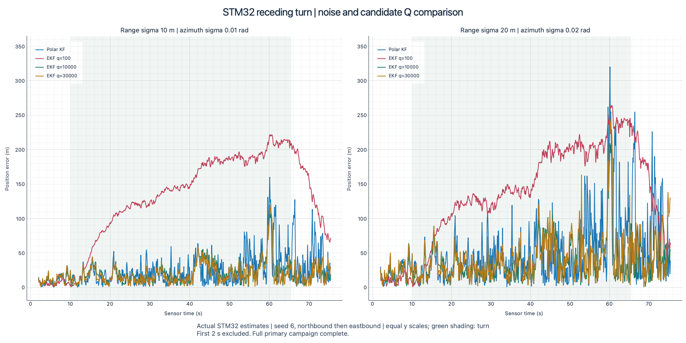
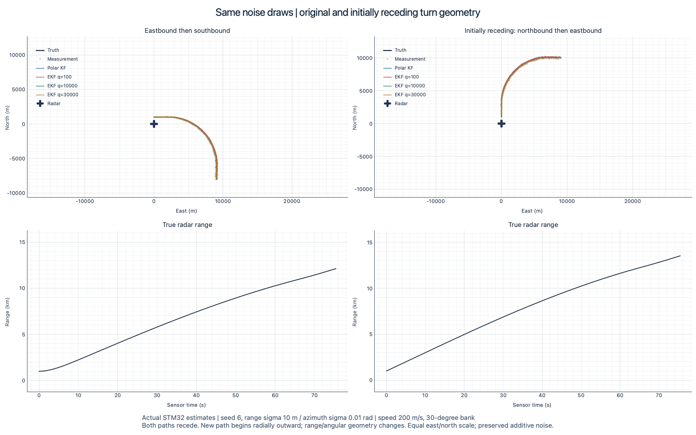
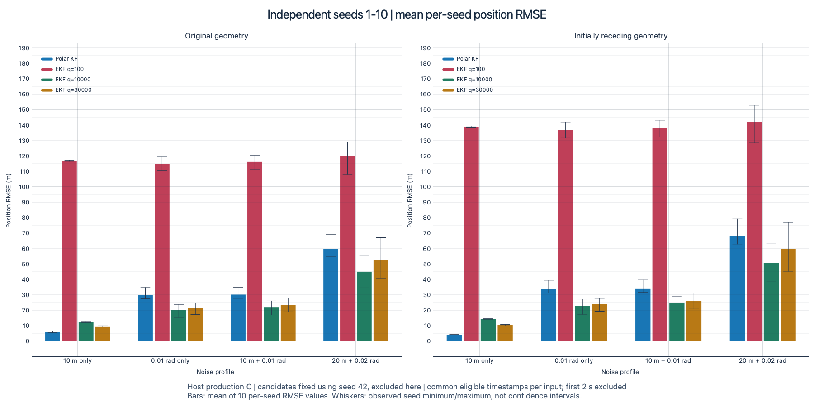
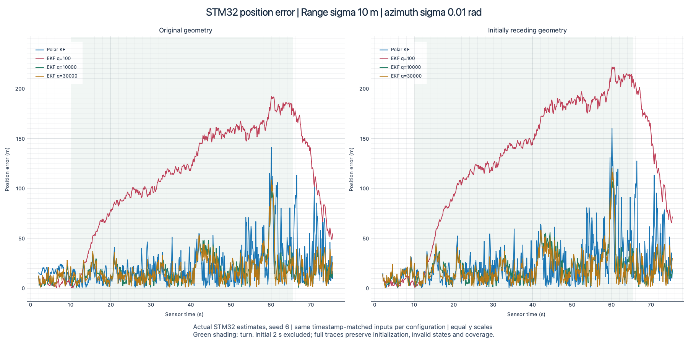
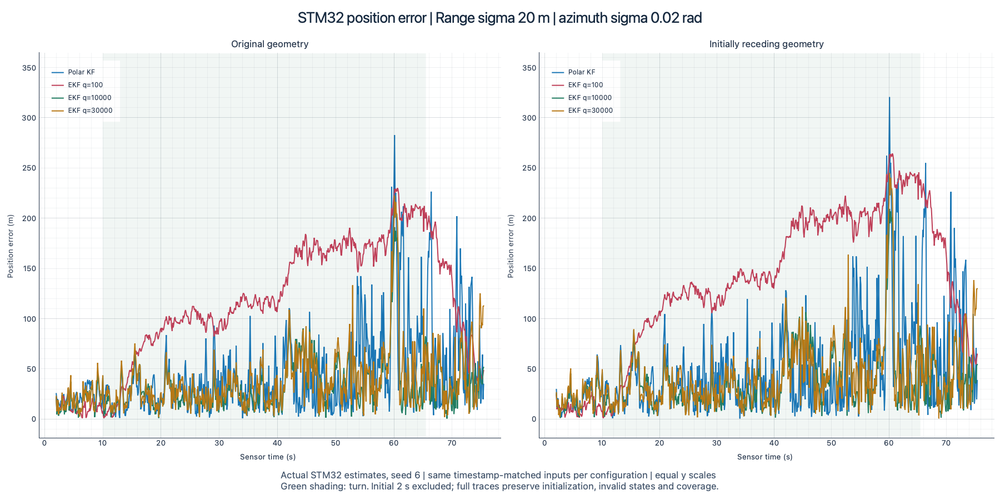
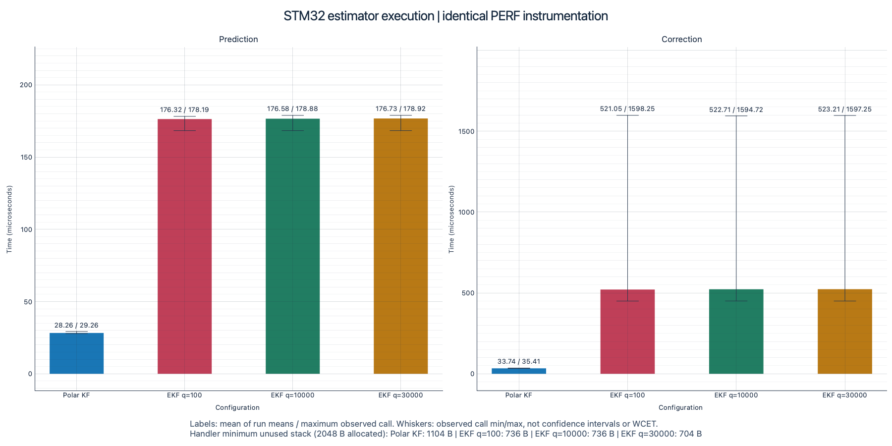

# EKF Q 후보의 독립 시드·이탈 선회·STM32 비교 — 2026-11-24

host336회와 STM32 주 비교44회·사후 진단2회를 완료했다. 실보드 측정34,730개 모두 대응했고 일반 KF 복원까지 확인했다. 기본 Q100과 기존 생산 코드는 유지한다.

## 목적과 비교 범위

seed42의 [앞선 Q 탐색](../ekf-q-2026-11-24/README.md)에서 정한 `10000·30000`을
후보로 고정하고, 기존 polar KF와 기본 Cartesian CV-EKF(`q=100`)를 비교한다.
펌웨어 기본값·수치 계산·R·초기 P·게이트·기존 테스트는 변경하지 않았다.
소스 기준은 `30a99d288fb9148eb35e84e11511ab24abcdfc02`이며 실험용 코드와 데이터만 추가했다.

`q`는 x/y 독립 가속도 분산의 공통 계수(m²/s⁴)다. R은 거리25m²·방위0.00121847rad²,
초기 속도0, 직사각형 게이트100m/10°, 측정 timeout1000ms를 유지한다.
같은 수치의 Q를 polar KF와 EKF에 강제하지 않는다. 두 모델의 상태와 과정 잡음의 의미가 다르다.

## 입력과 공정성

1. 기본 궤적은 시작점 `(동0m, 북1000m)`, 속도200m/s, 뱅크30°의 우90° 선회다.
   동쪽 직선10초 → 선회약55.49초 → 남쪽 직선10초이며 레이더 거리는1km→12.12km로 증가한다.
2. 추가 궤적은 같은 시작점·속도·선회율·구간 길이를 유지하고 **북쪽으로 이탈 → 우선회 → 동쪽**으로 간다.
   레이더 거리는1km→13.53km로 계속 증가한다. 기존 경로도 거리가 증가하므로,
   이번 비교는 시작부터 방사 방향으로 멀어지는 다른 거리·방위 기하 조건의 비교다.
3. 추가 궤적은 초기점을 중심으로 운동을90° 회전한 것이다. 기존 각 표본의 양자화 전
   거리·방위 가산 잡음을 그대로 보존한 후 새로운 truth에 더하고 wire를 다시 인코딩한다.
   잡음만 새로 추출하거나 추정기별로 다른 입력을 생성하지 않는다.
4. 입력은 10Hz 센서 시각의755개 표본이다. 모든 프레임과 truth를 시험 전에 저장하고,
   입력 해시를 확인한 뒤 각 구성에 같은 바이트를 전송한다. 검증기는 저장된 실제 초기 상태와
   segment 정보를 사용한다. 형식의 `straight_turn_straight` 이름과 기본 factory 경로를 혼동하지 않는다.

84개 입력: 궤적2개 × (seed42의 무잡음·기본 잡음2개 + 독립 seed1..10 × 잡음4조건).
host는 네 구성 모두 실행해336회·253,680표본이다. seed42는 후보 선택/재현 대조군이며
독립 시드 평균에서 제외한다. 두 궤적은 같은 잡음 표본을 공유하므로20개의 독립 시드로 세지 않는다.

| 잡음 조건 | 거리 σ (m) | 방위 σ (rad) |
|---|---:|---:|
| range | 10 | 0 |
| angle | 0 | 0.01 |
| nominal | 10 | 0.01 |
| strong | 20 | 0.02 |

주 실보드 행렬은 host 결과를 보기 전에 고른11개 입력 ×4구성 =44회다.
기존 궤적8개: 무잡음42, 기본 잡음42/3/6/9, 거리만6, 방위만6, 강한 잡음6.
추가 이탈 궤적3개: 무잡음42, 기본 잡음6, 강한 잡음6.
추가 이탈 조건은 해당 host 결과를 보기 전에 선택했다. 구성 순서를 조건별로 회전하고 매 실행마다 flash/재부팅한다.

host에서 발견한 `strong10`·`outbound-strong10`의 q=30000 게이트 거부는 별도 실보드2회로 재현했다.
이 두 실행은 결과를 보고 선택한 **사후 진단**이며, 주44회의 비교 통계에 섞지 않는다.

## STM32 전체 결과

주 비교44회와 사후 진단2회를 모두 완료했다. 측정 **34,730개** 모두 원시 송수신과 대응했고,
통신 오류0, LOST0회다. 주 비교 게이트 거부는0회, 사후 진단에서는2회였다.
두 실행 묶음 모두 종료 후 일반 KF를 복원하고 STATUS8개 항목0을 확인했다.
각 실행의 유효 추정값은755개, 초기2초 제외 평가 표본은735개다.
주 비교의 네 구성은 조건별로 같은735개 시각을 사용했다.

아래는 실제 STM32의 위치 RMSE(m)다. 행의 숫자는 난수 seed이며 무잡음에서는 seed가 측정값에 영향을 주지 않는다.

| 궤적 / 잡음·seed | KF | EKF100 | EKF10000 | EKF30000 |
|---|---:|---:|---:|---:|
| 기존 / 무잡음42 | 4.513 | 115.557 | 9.603 | 5.357 |
| 기존 / 기본42 | 26.817 | 119.373 | 22.282 | 22.484 |
| 기존 / 기본3 | 30.708 | 112.191 | 20.675 | 22.823 |
| 기존 / 기본6 | 30.277 | 120.035 | 22.253 | 22.324 |
| 기존 / 기본9 | 30.979 | 118.405 | 26.023 | 27.937 |
| 기존 / 거리만6 | 5.886 | 116.600 | 12.614 | 9.850 |
| 기존 / 방위만6 | 30.039 | 118.100 | 20.640 | 20.575 |
| 기존 / 강한6 | 60.025 | 129.042 | 41.906 | 47.568 |
| 이탈 / 무잡음42 | 0.974 | 137.610 | 11.714 | 6.560 |
| 이탈 / 기본6 | 34.289 | 142.683 | 25.396 | 24.985 |
| 이탈 / 강한6 | 68.461 | 152.821 | 47.149 | 53.273 |

기본 Q100의 큰 선회 오차는 두 후보에서 줄었다. 그러나 거리 잡음만 있는 조건에서는 기존 KF가
더 작고, 후보끼리의 순위도 잡음과 seed에 따라 달라진다. Q10000은 독립 시드의 방위 잡음 포함
조건에서 평균이 작지만 모든 개별 실행에서 최소는 아니다. 기본 Q는100으로 유지했다.

### 이탈 선회의 구간별 오차

모두 위치 오차(m)다. 전반 직선은2–10초, 선회는10–약65.49초, 후반 직선은그 이후다.
최대값은 전체735개 평가 표본에서 구했으며 순간 오차를 RMSE와 함께 보여준다.

| 잡음 / 구성 | 전체 RMSE | 전반 직선 | 선회 | 후반 직선 | 최대 오차 |
|---|---:|---:|---:|---:|---:|
| 기본 / KF | 34.289 | 12.688 | 33.520 | 47.719 | 160.333 |
| 기본 / EKF100 | 142.683 | 6.917 | 151.812 | 147.263 | 221.951 |
| 기본 / EKF10000 | 25.396 | 12.102 | 27.702 | 19.084 | 109.420 |
| 기본 / EKF30000 | 24.985 | 13.393 | 26.591 | 22.813 | 120.517 |
| 강한 / KF | 68.461 | 25.384 | 66.952 | 95.156 | 320.565 |
| 강한 / EKF100 | 152.821 | 12.774 | 163.101 | 154.536 | 264.386 |
| 강한 / EKF10000 | 47.149 | 23.437 | 50.102 | 44.360 | 209.289 |
| 강한 / EKF30000 | 53.273 | 25.834 | 54.762 | 60.675 | 245.026 |











### 단발 게이트 거부의 사후 진단

host 결과에서 선택한 강한 잡음 seed10/Q30000 두 실행은 주 비교 표·비용 집계에 포함하지 않았다.
거부 표본의 출력은 보정되지 않은 coast 예측값이므로 실제 wire 거리와의 차이로 게이트 잔차를 계산했다.

| 궤적 | 센서 시각(s) | 가산 거리 잡음(m) | 예측 거리 오차(m) | wire−예측 잔차(m) | 방위 잔차(°) | 다음 갱신까지(ms) |
|---|---:|---:|---:|---:|---:|---:|
| 기존 | 31.5 | -35.453 | 65.082 | -100.437 | 0.418 | 100 |
| 이탈 | 31.5 | -35.453 | 64.836 | -100.631 | 0.448 | 100 |

거리 잡음 하나가100m를 넘은 것이 아니다. 예측 거리 오차와 반대 방향의 측정 잡음이 합쳐져
100m 게이트를 조금 넘었다. 두 경우 모두 다음 센서 표본에서 CONFIRMED/UPDATED로 돌아왔고
LOST는 없었다. 위100ms는 센서 시각 차이이며 일반적인 재추적 시간이나 PC 지연을 뜻하지 않는다.
[개별 수치](gate-diagnostic.csv)와 [전후 표본](gate-window.csv)에 host/board 결과를 함께 보존한다.

### 실행 비용과 자원

주44회에서만 집계했다. 평균은 실행별 평균의 산술평균, 최대는 관측한 개별 호출 최대다.
스택은2048B handler 스택의 최소 잔여 관측값이며 최악 상황의 상한 증명은 아니다.

| 구성 | predict 평균/최대(µs) | correct 평균/최대(µs) | handler 최소 잔여(B) |
|---|---:|---:|---:|
| KF | 28.264 / 29.263 | 33.736 / 35.407 | 1104 |
| EKF100 | 176.321 / 178.189 | 521.049 / 1598.254 | 736 |
| EKF10000 | 176.578 / 178.875 | 522.711 / 1594.717 | 736 |
| EKF30000 | 176.734 / 178.916 | 523.214 / 1597.254 | 704 |



주 비교의 실제 PC 송신 간격은 실행별 평균103.584–104.432ms, 단일 최대298.220ms였다.
PC RTT의 실행별 p99 최대는16.947ms, 개별 RTT 최대는99.519ms였다.
보드 RX 완료→TX 큐 제출 최대는2ms, 20ms 초과는0회였다.
46회 전체의 host 생산 C 계산과 STM32 위치 차이는 최대0.017239m였다.
이는 같은 구현의 플랫폼 간 대조다. 별도 수학 구현이나 내부 공분산의 PSD/장시간 수치 안정성 증명으로 해석하지 않는다.

[전체 지표 CSV](summary.csv) · [전체 JSON](summary.json) · [공통 시각 비교](paired.csv) · [보드 전체 시계열](board-series.csv.gz) · [사후 진단 결과](diagnostic-summary.json)

## host 독립 시드 결과

아래는 각 조건의10개 시드별 위치 RMSE를 평균한 값이다. 표본을 합친 RMSE나 신뢰구간이 아니다.
모든336회에서755개 추정값이 유효하고, STARTED 후 첫2초 제외735개를 네 구성의 공통 시각으로 평가했다.

| 궤적 / 잡음 | KF (m) | EKF100 (m) | EKF10000 (m) | EKF30000 (m) |
|---|---:|---:|---:|---:|
| 기존 / 거리만 | 5.872 | 116.753 | 12.371 | 9.502 |
| 기존 / 방위만 | 29.892 | 114.906 | 20.102 | 21.339 |
| 기존 / 기본 잡음 | 30.129 | 116.149 | 22.005 | 23.391 |
| 기존 / 강한 잡음 | 59.711 | 119.959 | 44.943 | 52.524 |
| 이탈 / 거리만 | 3.919 | 138.854 | 14.221 | 10.337 |
| 이탈 / 방위만 | 33.900 | 136.848 | 22.824 | 23.902 |
| 이탈 / 기본 잡음 | 34.114 | 138.140 | 24.769 | 26.020 |
| 이탈 / 강한 잡음 | 68.188 | 142.062 | 50.661 | 59.654 |

q=10000은 이번 방위 잡음 포함 조건에서 후보30000보다 평균 오차가 작았다.
거리 잡음만 있는 조건에서는 기존 KF가 두 EKF 후보보다 작았고, EKF 후보끼리는30000이 작았다.
따라서 한 가지 설정의 보편적 우월성으로 해석하지 않는다. 기본값100도 이 시험으로 자동 변경하지 않는다.
이번 결과를 다음 튜닝에 사용하면 더 이상 손대지 않은 최종 평가 자료가 아니며 새 평가 조건이 필요하다.

## STM32 측정 방법과 한계

STM32F746G-DISCO, Zephyr4.2, USART6/ST-Link115200baud, 네 구성에 같은 `perf.conf`를 사용한다.
매 실행이 부팅부터 새 PERF 집계다. 기록은 입력·raw wire·TRACK/STATUS CSV·진단 console·flash 로그·전체 설정·이미지 해시를 포함한다.
정상 복원 이미지는 PERF를 끈 기본 KF `build/zephyr/zephyr.hex`다.

기존 `turn_noise.run`의 FIFO를 그대로 사용한다. 각 write 뒤 센서 dt만큼 수신하므로
실제 송신 간격은100ms보다 길어질 수 있다. 입력을 건너뛰거나 catch-up 전송하지 않지만 lockstep은 아니다.
기능·수치·관측 실행 비용의 비교이며 정확한10Hz 주기나50Hz 지속 부하/WCET를 입증하지 않는다.
PC RTT는 USB·UART·호스트 지연을 포함한다. 필터 predict/correct 계측과 구분한다.

RMSE는 해당 입력 시각과 일치하는 유효 추정값을 사용하고 매 STARTED 뒤2초를 제외한다.
유효 비율, 게이트 거부, 최대 연속 거부, LOST/STARTED와 warm-up/전체 유효 구간의 오차를 함께 보존한다.
상태가 무효한 표본을 작은 오차로 간주하지 않는다. 별도 정확도 합격 한계는 정의하지 않았다.

PERF 빌드 크기: KF Flash48,708B, EKF 세 구성56,332B, RAM모두21,184B.
실행 시간·스택은 실제 관측값이며 인터럽트/선점 영향과 계측 부하를 포함한다.

## 검증과 재현

- 입력84개를 저장 검증기로 검사했다. 이탈31,710개는 실제 초기 pose와 segment로 다시 적분하여
  위치 최대 차이7.30e-12m를 확인했다. 거리 잡음 보존 차이≤2.73e-12m, 방위≤2.23e-16rad다.
- host336회를 별도 디렉터리에서 다시 실행했고 두 궤적의 summary CSV/JSON과 전체 series gzip6개 파일이 바이트 동일했다.
- 생산 펌웨어/PC 코드는 앞선 commit과 같으므로 이전 Python1,058개+subtest9개 및 CTest95+ASSERT 비활성2회의 증거를 유지한다.
  이번에 새로 수행한 검증은 위 실험 입력/재현과 네 PERF 빌드·STM32 시험이다.
- 분석기는 raw wire를 재파싱해 입력→TX→TRACK timestamp/CSV 대응, STATUS0, CRC/누락/중복,
  PERF 오류와 host/STM32 상태·유효성·오차 차이를 검사한다. 단순히 평가기의 요약값만 복사하지 않는다.

실험 스크립트는 이 폴더에 있다. 생산 코드가 달라진 최신 revision에서 과거 실험을 재현한 것으로 표시하지 않는다.
호스트 입력 재생성 예시는 저장소 루트에서 실행한다. `previous-inputs`에는 앞선 KF/EKF archive의
`recording/inputs/{baseline,noisy}`가 있어야 한다.

```sh
python docs/test-results/ekf-q-board-2026-11-24/prepare.py --output /tmp/q-repeat --prior-inputs <previous-inputs>
python docs/test-results/ekf-q-board-2026-11-24/add_outbound.py /tmp/q-repeat
python docs/test-results/ekf-q-board-2026-11-24/check_inputs.py /tmp/q-repeat
```

입력 metadata의 source commit/dirty 값은 재생성 위치에 따라 달라질 수 있다. samples의 실제 프레임·수치와
host 집계/series를 비교하며, 실보드 재분석은 원래 보존한 입력을 사용한다.

후보 빌드는 Zephyr workspace에서 `perf.conf`와 이 폴더의 `configs/{kf,ekf100,ekf10000,ekf30000}.conf`를
각각 별도 빌드 디렉터리에 적용한다. `run_board.py --preflight-only`는 입력·설정·이미지 해시만 확인한다.
실제 실행은 STM32를 반복 flash하고 UART를 독점하며 종료/예외 시 기본 KF 복원을 시도한다.

Zephyr 환경에서 다음과 같이 빌드한다. `radar_repo`는 이 코드 revision을 체크아웃한 실제 경로다.
`-p always`는 해당 빌드 디렉터리를 다시 구성한다. 아래 명령은 빌드만 하며 flash는 실행기가 담당한다.

```sh
radar_repo=/absolute/path/to/radar-tracking-bench
west build -p always -d "$radar_repo/build" -b stm32f746g_disco "$radar_repo/fcc_app"
for variant in kf ekf100 ekf10000 ekf30000; do
  west build -p always -d "$radar_repo/build_q_$variant" -b stm32f746g_disco "$radar_repo/fcc_app" -- "-DEXTRA_CONF_FILE=$radar_repo/fcc_app/perf.conf;$radar_repo/docs/test-results/ekf-q-board-2026-11-24/configs/$variant.conf"
done
```

입력을 위의 `/tmp/q-repeat`에 재생성한 뒤 저장소 루트에서 보드 시험을 실행한다.
포트·west 실행 파일·Zephyr workspace 경로를 실제 환경에 맞춘다.

```sh
python docs/test-results/ekf-q-board-2026-11-24/run_board.py /tmp/q-repeat --data-port <data-port> --console-port <console-port> --west <absolute-west-path> --workspace <zephyr-workspace> --preflight-only
python docs/test-results/ekf-q-board-2026-11-24/run_board.py /tmp/q-repeat --data-port <data-port> --console-port <console-port> --west <absolute-west-path> --workspace <zephyr-workspace>
python docs/test-results/ekf-q-board-2026-11-24/prepare_diagnostic.py /tmp/q-repeat --output /tmp/q-diagnostic-repeat
```

첫 실행의 복원 완료 후 `/tmp/q-diagnostic-repeat`을 recording 인자로 같은 실행기를 호출하면
사후 진단2회가 수행된다. 이미 `board/`가 있는 기록 디렉터리에 덮어쓰지 않는다.


## 공개 원시 자료 재분석

[evidence.tar.gz](evidence.tar.gz)는 `primary/`와 `diagnostic/` 두 실행 묶음 및 `experiment/` 스크립트 스냅샷을 담는다.
입력·host trace·보드 raw wire/CSV·console·PERF·flash/build 로그·전체 `.config`·이미지 해시를 보존했다.
firmware HEX/ELF와 host 공유 라이브러리는 제외하며 로컬 원본에 유지한다.
내용이 같은 반복 파일은 tar hard link로 보관하고, 압축을 풀면 각각의 경로로 접근할 수 있다.
[archive 파일별 크기·해시](archive-inventory.json)와 [공개 자료 해시](SHA256SUMS)를 제공한다.
해시는 우발적 변경 감지용이며 서명이나 진위를 보장하는 인증은 아니다.

저장소 루트에서 공개 파일의 해시를 확인할 수 있다.

```sh
(cd docs/test-results/ekf-q-board-2026-11-24 && shasum -a 256 -c SHA256SUMS)
```

저장소 루트에서 실행한다. 이 명령들은 보드에 접근하지 않는다.

```sh
mkdir -p /tmp/radar-q-evidence
tar -xzf docs/test-results/ekf-q-board-2026-11-24/evidence.tar.gz -C /tmp/radar-q-evidence
python docs/test-results/ekf-q-board-2026-11-24/analyze.py /tmp/radar-q-evidence/primary --output /tmp/radar-q-primary-analysis
python docs/test-results/ekf-q-board-2026-11-24/analyze.py /tmp/radar-q-evidence/diagnostic --output /tmp/radar-q-diagnostic-analysis
python docs/test-results/ekf-q-board-2026-11-24/gate_diagnostic.py /tmp/radar-q-evidence/primary --diagnostic /tmp/radar-q-evidence/diagnostic --output /tmp/radar-q-gate-analysis
QT_QPA_PLATFORM=offscreen python docs/test-results/ekf-q-board-2026-11-24/plot.py /tmp/radar-q-primary-analysis
```

archive를 새 디렉터리에 풀어 재분석한 집계 JSON/CSV·보드 시계열·host 집계와 게이트 진단 파일이
공개 파일과 바이트 동일함을 확인했다. PNG는 화면 렌더러·폰트에 따라 바이트가 달라질 수 있다.
[검증 기록](verification.json)에는 archive898개 파일, 재분석11개 파일, 독립 host 재생성6개 파일과
실행 당시 소스/헤더42개 해시의 대조 결과를 남겼다. 그래프6종은 별도로 화면에서 확인했다.
입력은 합성 레이더 측정이며, 그래프의 보드 추정값은 실제 STM32 출력이다.
CT-EKF·S자/가감속·다른 속도/뱅크·실제 레이더 잡음 및 장시간 수치 안정성은 이번 시험에 포함하지 않는다.
