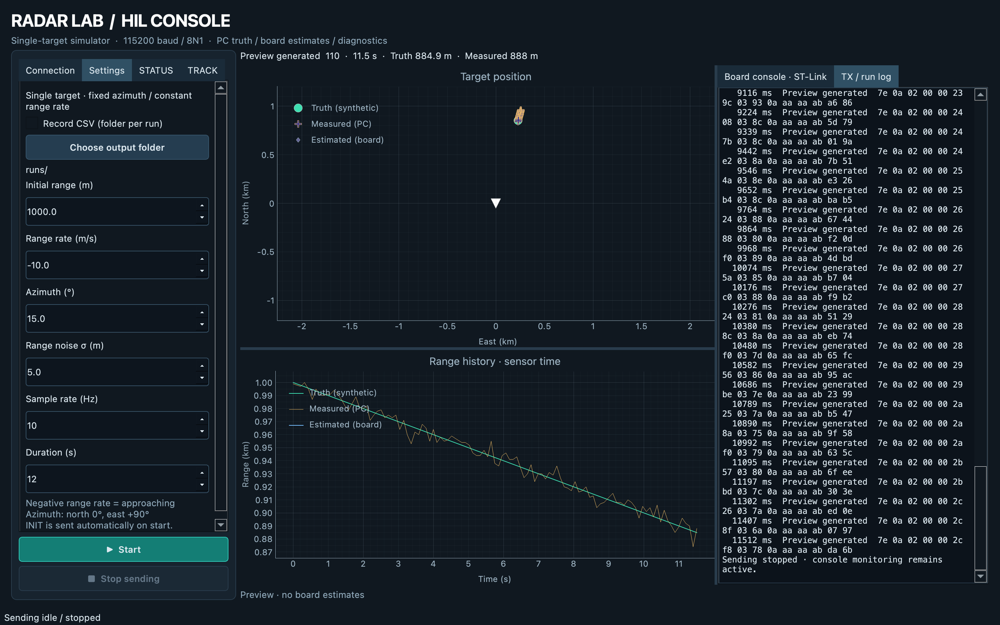
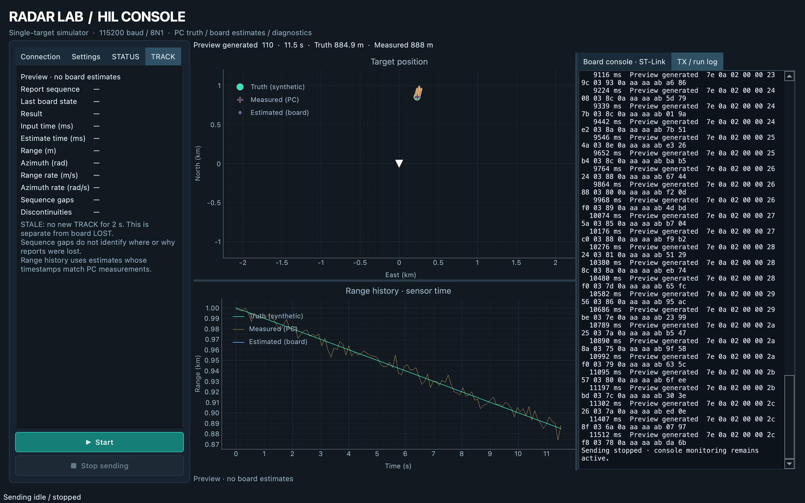
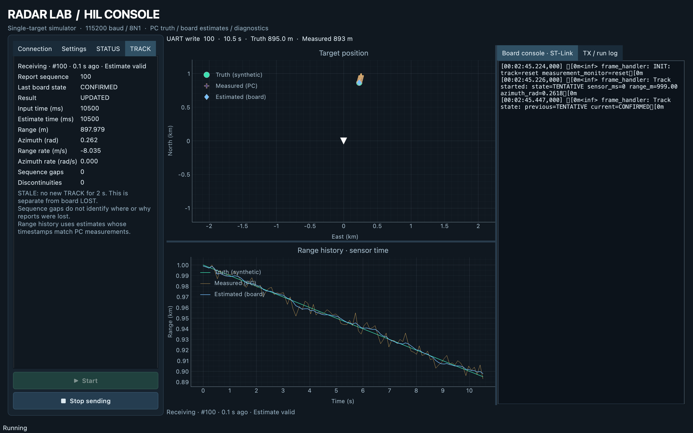

# Radar Lab GUI

기존 CLI와 같은 `protocol.py`로 INIT·측정 프레임을 만드는 PySide6/pyqtgraph 데스크톱 앱입니다.
단일표적 송신, PC 합성값과 보드 TRACK 추정값 비교, STATUS 통계·ST-Link 콘솔 확인에 사용합니다. 보드 추정값에는 TYPE=7을 송신하는 펌웨어가 필요합니다.

## 실제 앱 캡처

2026-11-23 영어 UI 코드에서 **보드 없이 미리보기 모드**로 실행한 캡처입니다. 설정·STATUS·TRACK 탭과 CSV 기록 UI를 포함합니다. PC 합성 데이터이며 보드 처리 결과 캡처가 아닙니다.

Settings 탭: 초기 거리·변화율·잡음을 설정하고 표적 위치와 거리 이력을 확인합니다.



TRACK 탭: 미리보기에서는 보드 추정값을 생성하지 않으므로 수신 대기 상태와 빈 추정값을 표시합니다. 오른쪽은 현재 CRC 프레임의 생성 로그입니다.



[캡처·다이어그램 갱신 방법](../tools/docs/README.md). 실제 보드 추정값은 [v1.1.0 실보드 검증](../docs/history/hardware-test-2026-11-23-v1.1.0.md)에서 실제 UART 수신 화면과 검증 결과를 확인할 수 있습니다.



GUI는 고정 방위각·일정 거리 변화율 모델입니다. 새 선회 시나리오는 `run_sim`에서 실행하며 GUI 시나리오 선택에는 아직 연결하지 않았습니다.

## 문서용 무음 시연

[40초 MP4](../docs/analysis/2026-11-23/gui-recorded-replay.mp4)는 2026-11-23의 별도 GUI 실보드 세션에서 저장한 측정 139개, TRACK 140개, STATUS 1개를 기존 화면에 재생한 영상입니다. 영어 Settings·TRACK·STATUS 화면을 보여주며, 재생과 일시정지 구간을 표시합니다. 새 UART 연결이나 새 실보드 실행은 없으며 제품 GUI의 재생 기능도 아닙니다.

[영상과 분석 보고서](../docs/analysis/2026-11-23/index.html) · [원본 출처와 재현 방법](../docs/analysis/2026-11-23/README.md)

## CRC 프로토콜 전환

현재 GUI는 `LEN + TYPE + PAYLOAD`에 CRC-16/IBM-3740을 계산하고 CRC 상위·하위 바이트를 붙입니다.
INIT은 `7e 01 01 00 c8 9d`, 측정 프레임은 15바이트입니다.
GUI와 CLI는 같은 인코더를 사용하며, GUI 그래프용 payload 해석에서도 CRC 2바이트를 제외합니다.
이미 실행 중인 GUI는 재실행해야 새 프로토콜이 적용됩니다. 보드도 CRC 펌웨어로 빌드·플래시해야 합니다.
이전 XOR 버전으로 수행한 보드 시험은 CRC 버전의 보드 검증을 대신하지 않습니다.

## 설치·실행

저장소 루트에서:

```sh
source ~/zephyrproject/.venv/bin/activate
python -m pip install -r pc_sim/requirements-gui.txt
python -m pc_sim gui
```

GUI 의존성은 선택 사항입니다. 기존 CLI에는 PySide6/pyqtgraph가 필요하지 않습니다.
macOS에서는 설치할 Qt 버전이 지원하는 운영체제 버전을 사용해야 합니다.
이 작업 환경에서는 PySide6 6.12.0, pyqtgraph 0.14.0으로 검증했습니다.

## 화면 구성

GUI의 탭·버튼·그래프·상태·오류 메시지는 영어로 표시합니다. 아래 절차는 실제 영문 레이블을 사용합니다.

왼쪽 패널은 **Connection / Settings / STATUS / TRACK / Tests** 페이지로 나뉘며, 상단의 두 열 버튼으로 선택합니다. 오른쪽 로그도 같은 방식으로 선택합니다. Connection 탭에서 모드·포트를 선택하고,
Settings 탭에서 초기 거리·변화율·방위각·잡음·주기·시간을 입력합니다.
가운데에는 표적 위치와 거리 이력 그래프가 위아래로 배치되고, 오른쪽에는 전체 높이를 사용하는 콘솔·실행 로그 탭이 있습니다.
왼쪽 조작 패널과 그래프 사이 경계, 그래프와 콘솔 사이 경계, 두 그래프 사이 경계를 드래그해 크기를 조절할 수 있습니다. 로그 영역은 기본적으로 좁게 표시하며 긴 결과를 읽을 때 넓힐 수 있습니다.
Start manual simulation·Stop sending은 수동 실행 버튼이며 Tests 탭에서는 숨깁니다. 작은 창에서는 탭 내부를 스크롤할 수 있습니다.
현재 지원 시나리오는 단일표적이며, 탭 번호가 표적 개수를 뜻하지 않습니다.

## 보드 없이 보기

1. 기본 `Preview · no board` 모드에서 `Connect preview`을 누릅니다. 시리얼 포트를 열지 않습니다.
2. `Settings` 탭에서 `Initial range (m)`, `Range rate (m/s)`, `Azimuth (°)`, `Range noise σ (m)`, `Sample rate (Hz)`, `Duration (s)`를 설정합니다.
3. `Start manual simulation`을 누르면 INIT 생성 후 실시간 속도로 측정을 생성합니다.
4. `Stop sending` 후 설정을 바꾸고 다시 시작할 수 있습니다.

음수 거리 변화율은 접근입니다. 방위각 입력 단위는 **도(°)**이며 내부에서 라디안과 semicircle로 변환합니다.
이는 int32 semicircle을 직접 받는 `radar_sender.py --azimuth`와 입력 단위가 다릅니다.
난수 seed는 42이며, 타임스탬프는 각 실행 시작 이후 PC monotonic 시계의 경과 시간입니다.
늦어진 송신을 몰아서 따라잡지 않으므로 실제 송신 주기는 설정값보다 느려질 수 있습니다.

## 실제 보드 사용

1. `Board UART · live transmission`을 선택합니다.
2. 포트 설명에서 후보가 하나씩 확인되면 USB-UART를 데이터, STM32/ST-Link를 콘솔로 자동 선택합니다. 사용자가 선택을 바꾸거나 None으로 지정하면 Refresh 시에도 유지합니다. 후보가 여러 개이거나 알 수 없는 장치이면 직접 선택합니다. 자동 선택만으로 연결하거나 송신하지 않습니다.
3. `Data port · USB-UART`에는 외부 USB-UART, `Console port · ST-Link`에는 ST-Link VCP를 선택합니다. 동일 포트는 허용하지 않습니다.
4. `Connect board`을 누른 뒤 `Start manual simulation`합니다. 시작마다 INIT을 한 번 전송합니다.
5. 콘솔에서 INIT·Track started를 확인합니다. 측정·예측·처리 결과 상세는 디버그 빌드에서 확인합니다.
6. `Stop sending`는 새 측정 송신만 멈춥니다. 콘솔은 유지되므로 보드의 timeout 로그를 볼 수 있습니다.
7. `Disconnect` 또는 창 닫기는 작업 스레드 종료와 포트 해제를 수행합니다.

데이터와 콘솔은 모두 115200 baud, 8N1, 흐름제어 없음입니다.
별도 터미널·CLI가 같은 포트를 사용 중이면 먼저 해당 연결을 종료하세요.
콘솔 포트를 생략하면 개별 측정의 보드 처리 로그는 볼 수 없습니다. STATUS 응답과 TRACK 추정값은 데이터 포트로 수신하므로 콘솔 연결 없이도 확인할 수 있습니다.
포트 열기·읽기·쓰기 오류는 실행 로그와 하단 상태줄에 표시합니다. 연결 오류 후 포트를 다시 선택해 재연결할 수 있습니다.
거리 또는 잡음이 wire 표현 범위를 벗어나면 값을 몰래 보정하지 않고 해당 실행을 중지합니다.

## 미리 설정된 보드 시험 실행

1. `Connection`에서 `Board UART · live transmission`과 데이터 포트를 선택합니다. 수동 세션이 연결되어 있으면 먼저 `Disconnect`합니다.
2. `Tests` 탭에서 시험을 선택합니다. 선택 메뉴는 두 열 버튼으로 표시하므로 좁은 창에서도 모든 이름이 보입니다.
3. 필요하면 `Choose output folder`로 저장 위치를 바꾸고 `Run Normal` / `Run Spike sweep`처럼 선택한 시험 이름이 표시된 버튼을 누릅니다.
4. 오른쪽 `Test results`에서 기존 CLI 출력·평가 수치를 확인합니다. `Open results folder`로 CSV·JSON을 열 수 있습니다.

| 선택 | 기존 CLI와 동일한 실행 |
|---|---|
| Normal | `evaluate run --scenario normal` · 120개, 10 Hz |
| Noisy | `evaluate run --scenario noisy` · 거리 잡음 σ 8 m |
| Dropout | `evaluate run --scenario dropout` · 4.0초 이상 5.5초 미만 측정 생략 |
| Noise sweep | `noise-sweep` · 기본 100회, 약 25분 |
| Turn + noise | `turn-noise` · 직진→우90°선회→직진, 755개, 10 Hz, 거리 σ10 m / 각도 σ0.01 rad, seed42 |
| Spike sweep | `spike-sweep` · 기본 49회, 약 12분, 100 m / 10° 게이트 가정 |

각 명령에는 선택한 `--port`와 실행별 `--output` 경로를 전달합니다. Normal·Noisy·Dropout·Turn + noise에서는 Tests의 `Range noise σ (m)`와 `Azimuth noise σ (rad)`를 입력할 수 있습니다. 0은 해당 잡음 없음이며, 시험 선택 시 기존 기본값(Normal 0/0, Noisy·Dropout 8/0, Turn + noise 10/0.01)이 채워집니다. 직선 평가기의 각도 옵션은 도 단위이므로 GUI가 rad→deg로 변환합니다. Sweep은 자체 조건 목록을 사용합니다. 그 외에는 CLI 기본값을 사용하므로 `Settings` 탭의 수동 실행 설정은 적용하지 않습니다. 시간은 대략적인 값이며 호스트·보드 상태에 따라 늘어날 수 있습니다.

시험 프로세스가 데이터 포트를 단독으로 소유하며 수동 연결·Start·STATUS는 잠깁니다. ST-Link 콘솔과 실시간 그래프는 이 시험 경로에서 수집·갱신하지 않습니다. 이전 그래프는 시험 시작 시 비웁니다. 로그가 없는 구간에도 경과 시간을 표시하며 진행률을 추정하지 않습니다.

`Completed`는 CLI의 정상 종료입니다. Normal/Noisy/Dropout의 RMSE나 Noise sweep 기록 완료를 정확도 합격으로 해석하지 않습니다. Spike sweep의 통과·실패 판정은 기존 CLI 출력에 따릅니다. `Failed`는 비정상 종료이며 상세 오류는 로그에 남습니다.

`Cancel test` 또는 창 닫기는 macOS/Linux에서 SIGINT로 종료·포트 정리를 요청합니다. 5초 내 종료하지 않으면 강제 종료하며 Windows에서는 terminate를 사용합니다. 중단한 시험은 `Cancelled · incomplete`로 표시하고 부분 파일을 유지합니다. 창은 자식 프로세스가 종료한 뒤 닫힙니다. 중단 파일은 완주 결과로 사용하지 않습니다.

기본 결과 위치는 `runs/tests/<실행 ID>/`이며 그 아래에 기존 평가기의 세션·sweep 결과가 저장됩니다. 테스트 로그 창은 최근 4000줄을 표시합니다. 실제 보드가 없는 경우에는 기존 Preview를 사용하며 Tests 시험을 보드 처리 결과처럼 모사하지 않습니다.

## 화면에서 확인할 수 있는 것

- `Target position`: 합성 실제값, 최근 PC 측정값 100개, 유효하고 신선한 최신 보드 추정값. 북쪽 0°, 동쪽 +90°.
- `Range history · sensor time`: 최근 2000개 실제값·정수 양자화된 측정값과 보드 추정값. 축은 크기에 따라 m/km로 표시될 수 있습니다.
- 생성/송신 개수: 미리보기 생성 횟수 또는 serial write 완료 횟수입니다. 보드 수신 ACK가 아닙니다.
- `Board console · ST-Link`: ST-Link에서 받은 실제 텍스트입니다. 추정값을 별도 파싱해 그래프에 표시하지 않습니다.
- `TX / run log`: INIT, 측정 프레임, 중지·완료·오류. 각 로그 창은 최근 2000줄을 유지합니다.

CSV 기록과 오프라인 RMSE 평가를 지원합니다. BIT, COMMAND, 다중표적은 구현하지 않았습니다. [TRACK 지원 경계](README.md#track_report-지원-상태).
이 GUI는 단일표적의 고정 방위각·일정 거리 변화율 시나리오입니다.
`run_sim.py`의 다중표적 시나리오 선택기는 포함하지 않습니다.

## TRACK 수신과 유효성

- 초록색은 PC 합성 실제값, 노란색은 PC 측정값, 파란색은 TYPE=7에서 해석한 보드 추정값입니다. 콘솔 텍스트에서 수치를 추출하지 않습니다.
- TRACK 탭은 순번·상태·처리 결과·입력/추정 시각·거리/각도·변화율과 순번 공백을 보여줍니다. 무효 필드는 `—`로 표시합니다.
- `ESTIMATE_VALID=0`이면 현재 위치를 숨기고 거리 곡선을 끊습니다. 유효 플래그가 설정된 숫자 0은 그대로 표시합니다.
- 새 순번의 유효한 TRACK payload가 **PC monotonic 기준 2초** 동안 없으면 STALE입니다. 현재 위치를 숨기고 지난 이력은 흐리게 남깁니다. 표시된 마지막 보드 상태를 LOST로 바꾸지는 않습니다. 이 2초는 `TrackMonitor.STALE_AFTER_S`이며 펌웨어 timeout 설정과 별개입니다.
- timestamp 역행 거부(TIME_REJECTED)는 이전 추정 시각을 유지합니다. 그래프는 `estimate_timestamp_ms`가 보관 중인 PC 측정 시각과 일치할 때만 그리며, 현재 송신값이나 PC 수신 시각에 임의로 붙이지 않습니다.
- 순번은 uint32 wrap을 허용합니다. 동일 순번은 중복으로 무시하며 수신 신선도도 갱신하지 않습니다. 역행/반주기 이상 이동은 불연속으로 세고 이력을 새로 시작합니다. 재부팅 원인이나 유실 위치를 확정하지 않습니다.
- 새 연결/시뮬레이션 시작은 화면 이력을 초기화합니다. INIT ACK·세션 ID가 없어 재시작 직전 대기 보고와 같은 timestamp의 새 실행을 완전히 구분할 수는 없습니다. CSV는 실행별로 분리하지만 wire 세션 ID 기반 경계 확인은 후속 작업입니다.
- 송신 중지 후에도 데이터 수신·STATUS·콘솔은 유지합니다. 미리보기에서는 보드 값을 생성하지 않습니다. INIT/RESET·무수신 timeout은 입력 없는 RESET 보고를 제출합니다. 원인별 구분은 없으며 실제 보드 왕복을 확인했습니다.

## 코드와 테스트

- `gui.py`: 화면·차트·사용자 조작.
- `gui_worker.py`: QThread에서 포트 소유, 송신 스케줄, 콘솔 읽기. GUI 갱신은 signal로 전달합니다.
- `gui_model.py`: 설정 검증·측정 생성·TRACK 이력/STALE 정책. `protocol.py`의 wire 인코딩을 공유합니다.
- `tests/simulation/test_gui_model.py`: 단위·프레임·거리 경계·설정 검증.
- `tests/ui/test_gui.py`: offscreen Qt에서 시작·중지·재시작·종료와 모사 serial의 INIT 순서·오류·포트 해제 검사.

```sh
python -m pytest tests/transport/test_track_report.py tests/simulation/test_gui_model.py tests/ui/test_gui.py tests/transport/test_crc_interop.py -q
```

GUI 라이브러리가 없으면 Qt 테스트 모듈은 skip됩니다. 모사 serial 테스트는 실제 보드 통신 검증을 대신하지 않습니다.
Qt 실행 흐름은 [공식 QThread 문서](https://doc.qt.io/qtforpython-6/PySide6/QtCore/QThread.html)를 참고합니다.

## 실제 보드 검증

2026-11-01 최신 펌웨어로 GUI 연결·송신·중지 후 timeout·재시작·재연결·종료를 확인했습니다.
[실제 화면과 결과](../docs/history/hardware-test-2026-11-01.md)를 참고하세요.

펌웨어 STATUS는 USART6 STATUS_REPORT 제출까지 구현되어 있습니다. ST-Link DEBUG 로그는 큐 접수만 표시하며 여덟 통계값은 wire 응답으로 조회합니다.
GUI의 STATUS 탭에서 수동 조회와 USART6 응답 디코딩을 제공합니다. [2026-11-12 실보드 시험](../docs/history/hardware-test-2026-11-12-status.md)에서 통계 표시·측정 병행·송신 중지 후 조회를 확인했습니다.

측정 생성은 `FRAME_TYPE_MEAS_REPORT`(0x02)를 사용합니다. `FRAME_TYPE_STATUS_REPORT`(0x06)는 펌웨어에서 송신하며 GUI에서 응답 통계를 표시합니다.


## STATUS 조회

보드 모드로 연결한 뒤 STATUS 탭의 `Query STATUS` 버튼을 누릅니다. 미리보기에서는 비활성화됩니다.
`CRC errors`, `Length errors`, `Frame timeouts`, `RX queue drops`, `Ring overflows`, `ISR dropped bytes`, `Recovery discarded bytes`, `Stale measurements`와 `Last successful query` 시각을 표시합니다.
구형 16/28바이트 응답에서 없는 항목은 `Unsupported`으로 표시합니다. 필드와 표시 이름은 `protocol.py`의 `STATUS_FIELDS`를 공유합니다.
조회 중에는 중복 요청을 막고 2초 동안 유효한 응답이 없으면 실패를 표시합니다.
실패 시 이전 값과 성공 시각을 유지하며, 연결을 새로 맺으면 이전 표시를 지웁니다.
측정 송신 중에도 조회할 수 있고 송신 중지 후에도 연결이 유지되면 조회할 수 있습니다.

기존 SessionWorker가 데이터 포트를 단독 소유하고 비차단 read와 프레임 파싱을 수행합니다.
CLI를 따로 실행하거나 수신 버퍼를 flush하지 않습니다. 손상 프레임·다른 TYPE·잘못된
STATUS payload는 건너뜁니다. 연결 해제/통신 오류로 종료하면 대기 요청도 취소합니다.
물리 통신 실패는 연결 종료로 이어질 수 있지만 응답 timeout만으로 측정 송신을 중단하지 않습니다.
프로토콜에 요청 ID가 없어 이전 요청의 늦은 응답과 새 응답의 완전한 구분은 보장하지 않습니다.
자동 주기 조회는 없습니다. 보드 TX(PC6)와 어댑터 RXD 연결이 필요합니다.

28바이트 응답의 [실보드 시험·실제 캡처](../docs/history/hardware-test-2026-11-14-status-extended.md)에서 일곱 통계 표시와 측정 병행 조회를 확인했습니다.

일반 펌웨어는 INFO 이상만 출력하므로 측정·예측·보정 상세 텍스트는 보이지 않습니다.
상세 콘솔 관측에는 debug.conf 빌드를 사용합니다. STATUS 조회는 두 빌드 모두 동일합니다.
[펌웨어 로그 설정](../docs/board-bringup.md#펌웨어-로그-설정).

## CSV 기록

Settings 탭의 `Record CSV (folder per run)`를 체크하고 `Choose output folder`로 저장 위치를 선택한 뒤 시작합니다.
기본 위치는 실행 디렉터리의 `runs/`입니다. 송신을 중지해도 수신/timeout 기록은 유지하며,
재시작하면 이전 파일을 닫고 새 폴더를 만듭니다. 연결 해제·창 종료에서 파일과 포트를 정리합니다.
미리보기도 기록할 수 있지만 mode=preview이며 보드 RMSE 평가에는 사용할 수 없습니다.
현재 화면의 2000개 표시 한계와 CSV 기록 범위는 별개입니다. ST-Link 콘솔 텍스트는 CSV 저장 대상이 아닙니다.
보드 기록은 `python -m pc_sim evaluate report SESSION_DIR`로 평가합니다. [필드·평가 정책](README.md#csv-수집과-정량-평가).

2026-11-18 실제 UART를 연결한 offscreen Qt 검증에서 13개 확인 항목을 통과했습니다.
추정 곡선·CONFIRMED·STATUS 8개 통계·timeout·STALE·CSV 재시작/종료를 확인했습니다.
1280×850 및 1000×650 캡처를 검토했으며 사람이 native 창을 직접 조작한 시험은 아닙니다.


[결과·작은 창·STALE 캡처](../docs/history/hardware-test-2026-11-18-evaluation.md).

콘솔 본문은 `항목: key=value` 형식이며 단위는 키에 표시합니다. GUI 콘솔은 원문을 표시하고, 보드 추정값·STATUS는 이진 프레임을 해석하므로 로그 문자열에 의존하지 않습니다. [펌웨어 로그 설정](../docs/board-bringup.md#펌웨어-로그-설정)을 참고하세요.

## 위치 그래프 확대와 콘솔 표시

`Target position` 위 선택 메뉴의 기본값은 `Follow target`입니다. 현재 합성 실제값을 중심으로 최근 2초 측정 위치·신선한 보드 추정값과 잡음 크기에 맞춰 표시 범위를 조절합니다. 최소 반폭은 10 m이며 실제 측정값을 증폭하거나 수정하지 않습니다. 속도가 빨라 최근 위치 간격이 커지면 범위도 커집니다.

`Full range`는 레이더 원점과 초기 거리 기준 전체 범위, `Manual zoom`은 마우스 휠·드래그로 선택한 범위를 유지합니다. 자동 시험의 그래프는 아직 갱신하지 않습니다.

Console은 UART에서 나뉘어 들어오는 ANSI 색상 제어 코드를 제거해 읽을 수 있는 텍스트로 표시합니다. 원본 기록과 펌웨어 로그 형식은 바꾸지 않습니다.
